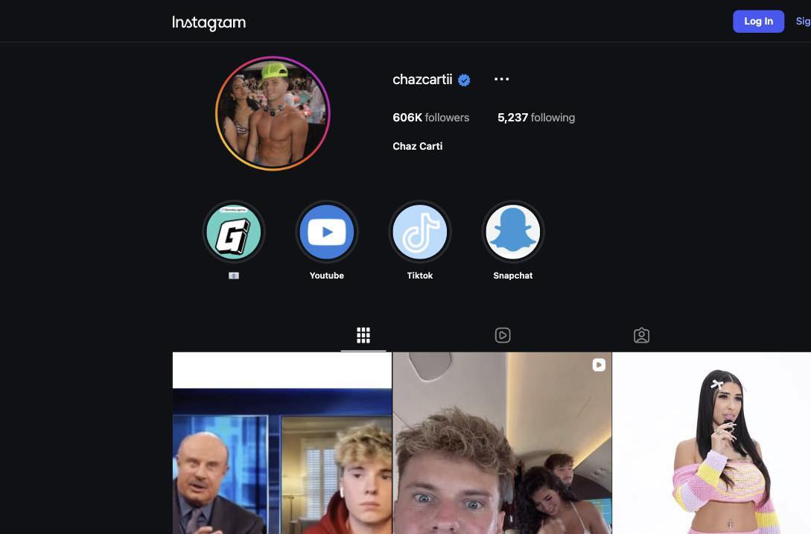
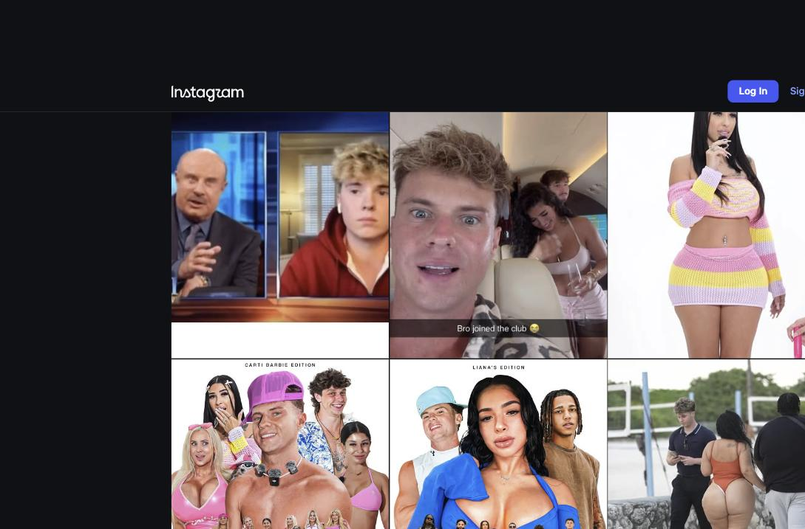
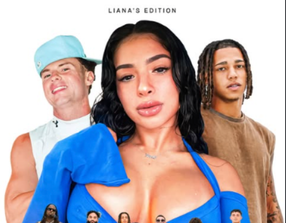
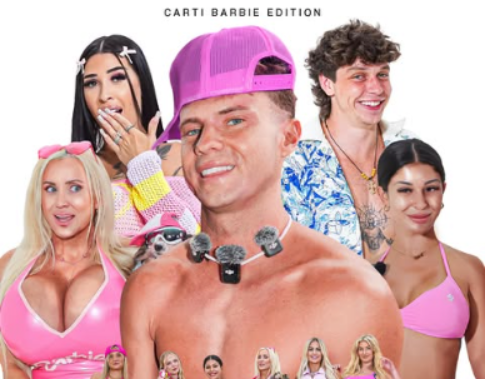
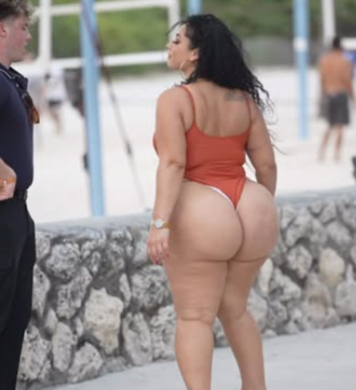
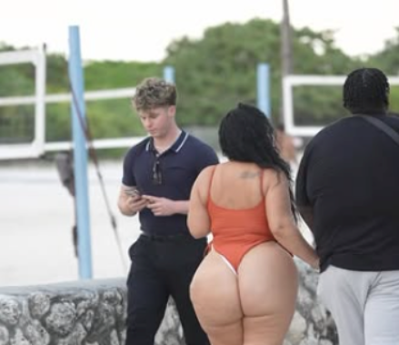
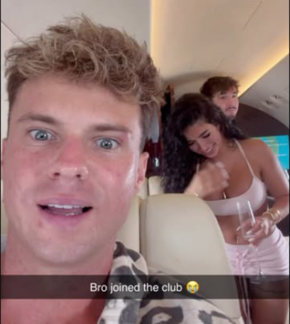

# Instagram Account Audit — @chazcartii

**Prepared:** September 12, 2026  
**Account:** https://www.instagram.com/chazcartii/ (verified, 606K followers, following 5,237)  
**Audited by:** ALTR  
**Scope:** Public profile, funnel destinations (YouTube channel + Linkme page), pinned post, and the 11 most recent grid posts/reels. This audit was run from a logged-out view: stories/highlights content, reel view counts, Account Status internals, and anything follower-gated were not visible — Section 6 tells the client what to pull themselves.

---

## 1. Executive Summary

**Overall risk grade: D+**  
**Primary problem in one sentence:** The Instagram account has been converted into a promo funnel for the "Carti Parti" YouTube dating show — sexualized cover art and body-focused clip selection in most recent posts, plus an off-platform CTA in nearly every caption — a combination that makes the majority of recent content non-recommendable and has very likely triggered account-level reach suppression.  
**Is account-level recommendation ineligibility likely active?** Probably. Recent reels earn 2.7K–8.2K likes against 606K followers with no breakout outliers (viral-format content on a healthy account this size shows regular 10x spikes from non-follower distribution), and the static "OUT NOW" promo posts collapse to 17–36 comments. Confirm with Account Status (Section 6).

The good news up front: this is **not** an unfixable format. The underlying YouTube show is a consent-based dating format — participants are on-camera willingly and are tagged collaborators on Instagram. Nothing we found is imminent-removal territory. The problem is packaging: the clips and posters chosen for Instagram consistently lead with women's bodies rather than the show's actual product (banter, reactions, dating chaos), and every caption is a traffic push. Instagram's classifier scores exactly those two things. There is also a broken-funnel business problem stacked on top: the channel the account relentlessly promotes was deleted and rebuilt (now 11.8K subscribers against 606K IG followers), and several posts still advertise a dead URL.

**Findings at a glance:** 0 Critical · 6 High · 5 Medium · 3 Low

<figure><figcaption>Profile at audit time: verified, 606K followers, following 5,237. No bio text or link; the highlight row (YouTube / TikTok / Snapchat) is the only on-profile funnel.</figcaption></figure>

---

## 2. Account-Level Findings

### HIGH — Recurring body-first content pattern is dragging the whole account
- **What we found:** Of the 11 recent grid posts, 7 lead visually with women's bodies: two beach reels framed directly on a woman's exposed backside, two promo posters built around bikini lineups ("BLIND SPEED DATING 10 BARBIES", "10 degens vs @lianalovexo" with chest-centered cover art), the mile-high-club innuendo reel, and two nightclub/pickup clips.
- **Policy tripped:** Sexually suggestive content — Recommendation Guidelines (reach-demotion layer). No single post is a removal risk, but Instagram scores the *account pattern*, and past ~30% of recent posts scoring here, the entire account loses Explore/Reels/suggested-post distribution — including for clean posts.
- **Why it's flagging:** The classifier keys on framing (what the shot centers on), not nudity. A dating-show clip where the frame is the cast's reaction is recommendable; the same episode promoted with a butt-centered beach shot is not.
- **Fix options:**
  - *Adjust:* Re-cover and recut the flagged posts per Section 3 — in most cases the same episode has usable reaction-led footage.
  - *Rework:* Change the promo formula going forward (see Section 5 "Ongoing") — faces, banter, and payoff moments as the hook.
  - *Remove:* Archive the two beach reels (items 6 and 11) if not recut within the week.
- **Our recommendation:** Adjust + rework. The show survives intact; only the packaging changes.

<figure><figcaption>Top of the grid at audit time — what the classifier scores as the account's recent pattern: jet-innuendo reel, body-focused studio shot, bikini-lineup posters, and a beach reel framed on a woman's backside, side by side.</figcaption></figure>

### HIGH — Broken and dead funnel: deleted YouTube channel still advertised
- **What we found:** Multiple posts and pinned comments advertise "youtube.com/cartiparti" — that URL now resolves to an unrelated, empty 4-subscriber channel. The real rebuilt channel is **@CartiPartii** (double i, 11.8K subscribers, 320 videos). A commenter on the Aug 23 post confirms: "I was gonna watch it on the old channel before it got deleted."
- **Policy tripped:** None directly on Instagram — but a prior channel deletion is cross-platform enforcement history, and it means the account is burning its remaining reach driving traffic to a dead link.
- **Why it matters:** The client should establish *why* the old channel was terminated (YouTube sends the strike/termination reason by email). If it was a policy termination — plausible given episode titles like "Blind Dating Based On Their Bodies!" and "Adult Film Star Dates 5 Guys At Once!" — the same packaging instincts are now endangering the Instagram account. Platforms' adult-adjacent standards have converged; treat the deletion as a warning shot.
- **Fix options:** *Adjust:* correct every live reference (pinned comments, poster art on future posts) to the working destination; *Remove:* archive old promo posts pointing at the dead URL (they have no ongoing value).
- **Our recommendation:** Do both this week.

### HIGH — Casino sponsor promoted on-platform (and in the link funnel)
- **What we found:** The **Rainbet crypto-casino logo is printed directly on the Aug 10 promo poster posted to Instagram** (bottom-left corner, opposite the Carti Parti mark) — and the Linkme aggregator (link.me/chazcartii, advertised on the YouTube channel) carries a **"Rainbet 🤑"** referral entry alongside a "LIVE NOW" streaming link.

<figure><figcaption>Bottom strip of the Aug 10 "NEW VIDEO OUT NOW" Instagram post: the Rainbet casino logo (bottom-left, cursive) is part of the poster artwork itself — on-platform gambling promotion, with no paid-partnership label.</figcaption></figure>

- **Policy tripped:** Online gambling is restricted on Instagram — real-money gambling promotion requires prior written permission from Meta, which sponsor-logo placement on a post does not have. This is enforceable at the removal/strike layer, and the post also lacks the required paid-partnership label (Meta branded-content policy + FTC disclosure exposure if the sponsorship is compensated).
- **Why it matters:** This is the account's most straightforwardly *strikeable* pattern — unlike the suggestive-content findings, which are demotion-layer. A gambling-sponsor watermark on future posts stacks a restricted-goods signal on top of an already-suppressed account, and bridging the Linkme (with its Rainbet referral) into the empty Instagram bio would compound it further.
- **Fix options:** *Adjust:* strip the Rainbet mark from all future Instagram poster artwork (keep the sponsorship on stream platforms where it's permitted and disclosed); *Remove:* archive the Aug 10 poster (it's low-value funnel content anyway) and drop Rainbet from any page reachable from Instagram.
- **Our recommendation:** Archive the poster today, keep gambling branding permanently off Instagram-visible surfaces, and never put the Linkme in the IG bio while it carries the referral.

### MEDIUM — Every caption is an off-platform CTA
- **What we found:** 9 of 11 recent captions are some form of "OUT NOW / YouTube: Carti Parti," including on reels whose content has nothing in the caption about what's happening in the clip.
- **Policy tripped:** Not a violation — but Instagram's ranking systems deprioritize pure traffic-arbitrage posting, and static "NEW VIDEO OUT NOW" posters are the account's worst performers by an order of magnitude (17–36 comments).
- **Fix:** See Section 5 — captions should carry the moment ("She said she doesn't go out. Her friends disagreed."), with the YouTube pointer demoted to a pinned comment. Kill the static poster format entirely; post the episode's best 60–90 seconds as a native reel instead.

### MEDIUM — Degrading comment sections left standing on featured women
- **What we found:** On the two beach reels, top comments include body-shaming and sexual commentary about the featured women ("🤢", "-1000", "She's as big as…", explicit remarks about swimwear), plus recurring "name?"/"Girls @?" identity-hunting. On the Aug 14 reel, top comments explicitly frame the content as adult-industry casting ("Do a partnership OF", a Johnny Sins "roster of next generation of Adult Stars" joke with 5 likes).
- **Policy tripped:** Bullying/harassment signals (reach layer) — Instagram reads a creator's tolerated comment environment, and mass-visible sexual/mocking comments both invite reports and confirm the classifier's suggestive read of the content. It is also simply bad for the cast members the show depends on.
- **Fix:** *Adjust:* enable Hidden Words with a custom list (body-size insults, 🍑/🍆 clusters, "OF", "name?"), delete the standing offenders on the flagged posts, and restrict repeat offenders. 15 minutes of setup, permanent effect.

### LOW — Following count and profile hygiene
- Following 5,237 accounts at 606K followers reads as a legacy follow-back growth pattern; unfollow in batches to under ~1,000. The bio itself is nearly empty (no text, no link visible logged-out) — a one-line show description ("Home of the Carti Parti dating show 🦅 New episodes weekly") costs nothing and frames the account as a show brand rather than leaving the grid to speak for itself.

---

## 3. Content Findings (newest first)

| # | Post (date / desc) | Issue | Policy / Layer | Severity | Recommended action |
|---|--------------------|-------|----------------|----------|--------------------|
| 1 | Aug 29 reel — private-jet "record" bit w/ @brycehall, "Bro joined the club 🙈" (7.5K likes) | Mile-high-club sexual innuendo as the punchline; comment section litigating the women involved | Suggestive / demotion | MEDIUM | Recut ending or caption swap; clean comments |
| 2 | Aug 23 photo — "BLIND SPEED DATING 10 BARBIES OUT NOW" poster | Bikini-lineup promo art + dead-URL funnel; worst-performing format | Suggestive + funnel / demotion | MEDIUM | Archive; replace format permanently |
| 3 | Aug 16 photo — "10 degens vs @lianalovexo OUT NOW" poster | Chest-centered cover art; "degens" framing | Suggestive / demotion | HIGH | Archive or re-cover with cast reaction art |
| 4 | Aug 16 reel — "I have no words… @iamselenecastle" beach clip (4.5K likes) | Frame centers tagged participant's exposed backside; mocking comment pile-on | Suggestive + harassment signals / demotion | HIGH | Recut wide or archive; purge comments |
| 5 | Aug 14 reel — "YouTube: Carti Parti 😂" office/casting bit (2.7K likes) | Casting-couch optics; audience comments explicitly read it as adult-industry content | Suggestive / demotion | HIGH | Archive; this bit cannot be re-covered |
| 6 | Aug 10 photo — "NEW VIDEO OUT NOW 🦅" cast poster | Poster-funnel format **with Rainbet casino logo in the artwork** | Gambling promo / removal-risk + funnel | HIGH | Archive today |
| 7 | Aug 6 reel — pickup/rejection bit @chloeyummyx (6.9K likes) | Rejection-reaction structure; caption is pure CTA | Borderline / demotion | LOW | Caption rewrite only |
| 8 | Aug 6 reel — nightclub "worst luck imaginable 💀🥀" @madisonlmills (5.9K likes) | Reaction-bait overlay tone; identity-hunting comments | Borderline / demotion | MEDIUM | Soften overlay on future edits; clean comments |
| 9 | Aug 5 photo — birthday party photo | Clean | — | LOW | None — more of this |
| 10 | Jun 22 reel — "She seems loyal ✨" loyalty-test @itskorixo (8.2K likes) | Loyalty-test/relationship-drama format; best performer, participant tagged | Borderline / demotion | MEDIUM | Keep; format is at the edge — keep participants tagged and tone non-mocking |
| 11 | Jul 31 reel — "I have no words 😭" beach one-piece clip (6.5K likes) | Butt-centered framing of an **untagged** woman; explicit sexual + body-shaming comments standing | Suggestive + harassment signals / demotion | HIGH | Archive today unless she can be tagged/confirmed as cast; purge comments |
| P | Pinned Jan 2022 reel — Dr. Phil ocean joke (3K likes) | Clean legacy comedy; third-party TV footage | Originality (minor) | LOW | Keep |

### Detailed notes on the HIGH items
**#3 poster & the promo formula:** the show's YouTube thumbnails and IG posters are built like adult-site banners — a lineup of bodies with the host inset. Compare item 9 (a plain party photo) and item 10 (a face-and-conversation clip, the account's best number). The evidence in this grid says reaction-led content outperforms body-led content *on this very account*. Replacement poster spec: the episode's funniest on-set moment as a still, faces large, episode title in the same "CARTI PARTI" type treatment, no swimwear lineup.

<figure><figcaption>Item #3 (Aug 16): the "LIANA'S EDITION" poster — the composition centers the guest's chest; the cast faces are pushed to the edges. This is the exact framing the suggestive-content classifier scores.</figcaption></figure>

<figure><figcaption>Item #2 (Aug 23): "CARTI BARBIE EDITION" — same formula: bikini lineup as the hook. As a static funnel poster it is also among the account's worst performers (18 comments).</figcaption></figure>

**#4 and #11 beach reels:** identical fix — if raw footage exists, recut so the shot is the interaction (interviewer + participant in frame, wide), not the walk-away framing; swap cover frames to a face/reaction still. #11 is the single riskiest post on the grid: the woman is untagged (consent not evidenced on-platform), the framing is purely anatomical, and the comment section is openly degrading — that combination is what converts a demotion into a report-driven review. Archive it today if she isn't a taggable cast member.

<figure><figcaption>Item #11 (Jul 31): the frame is the subject's body, full stop — the interviewer is incidental. Untagged subject + this framing + the standing comment section is the account's highest-risk combination.</figcaption></figure>

<figure><figcaption>Item #4 (Aug 16, @iamselenecastle): same shoot, same anatomical framing. She is tagged (consent evidenced), so this one is recoverable with a recut and a face-forward cover frame.</figcaption></figure>

**#5 office reel:** when the audience's top comments are OnlyFans partnership jokes and adult-studio comparisons, the classifier and human reviewers see the same thing. No re-edit changes the premise; archive.

<figure><figcaption>Item #1 (Aug 29, with @brycehall): the "Bro joined the club 🙈" jet reel — the innuendo is the entire punchline. A recut that ends on the Bryce Hall cameo keeps the clip and drops the flag.</figcaption></figure>

---

## 4. Pattern Analysis

To a classifier, the recent grid reads as: *sexualized promo funnel for an off-platform show* — bodies as hooks, CTAs as captions, minimal native value. That pattern explains "flagged every few days" better than any single post: each new body-led post refreshes the account-level score, so restrictions keep re-arriving no matter which individual post gets appealed. The Jun 22 loyalty-test reel — faces, dialogue, a tagged participant — is the account's best performer at 8.2K likes, which is the strongest possible internal evidence that the audience is here for the show's chaos, not the anatomy. The account also has real assets most flagged accounts lack: a genuinely consent-based format, tagged and willing cast, a verified badge, and 606K followers who mostly can't currently be reached.

---

## 5. Action Plan

**Today (stop the bleeding):**
1. Archive item #11 (July 31 beach reel), item #5 (Aug 14 office reel), and item #6 (Aug 10 poster carrying the Rainbet casino logo).
2. Delete the standing degrading comments on items #1, #4, #8, #11; enable Hidden Words with a custom filter list (body-size insults, sexual emoji clusters, "OF", "name?", "@ her").
3. Remove "Rainbet 🤑" from link.me/chazcartii and strip the Rainbet mark from all future Instagram poster artwork.

**This week:**
1. Recut or archive items #3 and #4; archive the two static "OUT NOW" posters (#2, #6).
2. Fix every live "youtube.com/cartiparti" reference to the working channel; pull the old channel's termination email and share it with us — it determines how conservative the YouTube-side packaging needs to be.
3. Write the bio: "Home of the Carti Parti dating show 🦅 New episodes weekly."
4. Recut item #1's ending (cut before the "club" punchline lands on the innuendo; the Bryce Hall cameo carries the clip) or swap its caption to the collab angle.

**Ongoing format changes (the durable fix):**
1. New promo formula per episode: one native reel of the best 60–90 second moment (reaction-led edit, faces in frame, participants tagged), caption carrying the moment — e.g., for a speed-dating episode: *"He said his red flag was 'honesty.' Watch her face."* — YouTube pointer as pinned comment only.
2. Poster spec from Section 3 for any static promo (reaction stills, not lineups).
3. Cast-positive editing: end clips on the laugh, not on anyone's humiliation; participants tagged in every post. This format's compliant version is proven — consent-forward dating content is fully recommendable and is exactly what the show already is underneath the packaging.
4. Batch-unfollow to under 1,000 over 4–6 weeks; no automation tools during recovery.

**Expectations:** with the pattern above, expect 4–6 weeks of consistent posting before non-follower reach visibly recovers. Do not judge the plan at day 5, and do not let one soft week trigger a return to body-led thumbnails — that resets the account-level clock.

---

## 6. What the Client Needs to Pull (we can't see it from outside)
1. **Settings → Account Status** — screenshot both "Removed content" and "What can't be recommended," and appeal any listed item that Section 5 has already fixed.
2. **Insights → Reach → non-follower %** for the last 30 and 90 days (baseline for measuring recovery), plus view counts on items #1–#11.
3. The **YouTube termination email** for the original Carti Parti channel.
4. List of any third-party growth/scheduling tools with account access.

## 7. Re-audit
Recommended at **30 days**: confirm Account Status is clean, non-follower reach is trending up, and grade the new promo formula against the same rubric.

---
*This audit assesses compliance with Meta's published Community Standards and Recommendation Guidelines as understood at the audit date. Platform enforcement is partly discretionary; no compliance change guarantees restoration of reach. All recommendations aim to make content genuinely compliant — we do not advise tactics to disguise violating content, which converts reach problems into account-loss problems.*
