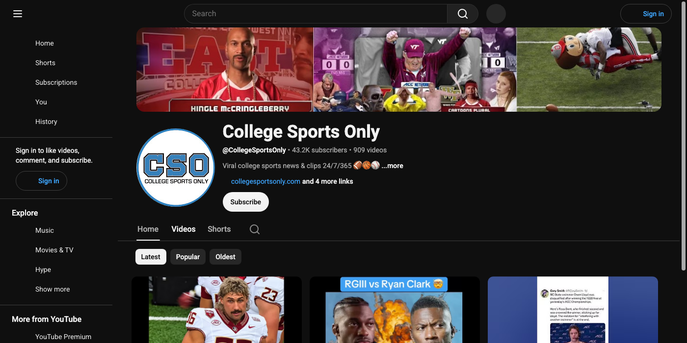

# Facebook Monetization Audit — College Sports Only

**Prepared:** October 21, 2026  
**Page:** facebook.com/CollegeSportsOnly  
**Audited by:** ALTR  
**Scope:** Monetization-eligibility diagnosis. Facebook Pages are not viewable logged-out, so the content mix is evidenced from the brand's own mirrors (YouTube @CollegeSportsOnly, 43.2K subs · 909 videos; TikTok; X), which run the same clip strategy — Section 6 lists the one-screen confirmation the client can pull from their Professional Dashboard.

---

## 1. Snapshot

Monetization grade

F

Content-eligibility failure

Account standing

Likely OK

No account problem expected

Library

909

Videos on the YT mirror alone

Original content

~1%

One interview in the recent set

The answer in one sentence

The client is right that nothing is "wrong" with the account — and that's exactly the problem: Facebook's Content Monetization Program pays only on ORIGINAL content, and this page's model (ESPN/FOX segments, NCAA broadcast moments, press conferences, memes — "viral college sports news &amp; clips 24/7/365" by its own description) is third-party footage that Meta classifies as unoriginal and Rights Manager matches as someone else's property, so every post can stay up, perform fine, and earn exactly $0.

---

## 2. The Diagnosis — Two Gates, and Which One Is Failing

**Gate 1 — Account eligibility** (what the client thinks is broken): program access, Page status, country, policy strikes. Almost certainly fine — if it weren't, the Professional Dashboard would show a named violation and content wouldn't just earn nothing, monetization tools would be locked.

**Gate 2 — Per-content eligibility** (what is actually failing): since Aug 31, 2025 the unified Content Monetization Program replaced in-stream ads, Ads on Reels, and the Performance Bonus — and it pays only on content Meta classifies as **original**. Third-party broadcast footage fails twice:
- **Originality:** reposted clips are ineligible even with a caption, logo, or short intro; "transformation" requires creator commentary that *dominates* the piece.
- **Rights:** NCAA game footage belongs to leagues, conferences, and networks. Meta's Rights Manager fingerprints it — the match doesn't always remove the post; it silently blocks or reroutes the payout to the rights-holder.

<figure><figcaption>The brand's own positioning: "Viral college sports news &amp; clips 24/7/365" — 909 videos. The recent set: ESPN's Ryan Clark vs. RGIII, Gus Johnson's best calls, College World Series broadcast moments, Saban/Leach pressers — all third-party footage. One original: their interview with FSU's viral punter.</figcaption></figure>

---

## 3. Findings

### HIGH — The clip model is now reach-threatening, not just unpaid

- Meta's March 2026 originality guidance escalated the stakes: accounts that repeatedly post mostly unoriginal material become **non-recommendable and demonetized at the account level** — and reshared content on Stories lost monetization eligibility in October 2026. The current model doesn't just earn $0; continued at volume, it will start costing distribution too.
- Severity note: this is a drift toward Gate-1 damage. The time to pivot is before Meta's classifiers reclassify the whole Page.

### MEDIUM — Format mix compounds it

- Meme/screenshot posts (tweet screenshots, image memes) earn nothing in CMP regardless of originality — payouts concentrate in original video.
- Viral-bait caption patterns ("you won't believe," tag-a-fan framing) sit in the clickbait/engagement-bait bucket that is both ineligible and eligibility-threatening under the Partner Monetization Policies.

### The bright spot — they already make the thing that pays

- The one original piece in the recent set (the sit-down interview with the viral Florida State punter) is **exactly** the format CMP monetizes: creator-shot, creator-owned, sports-passionate. The pivot isn't a new brand; it's inverting the ratio.

---

## 4. The Pivot

Monetizes — scale this

<ul>
<li>Original interviews (the punter format) — athletes, coaches, NIL stories</li>
<li>Face-and-voice commentary shows: rankings, debates, predictions, reactions where THEIR take dominates the screen time</li>
<li>Original on-campus / gameday atmosphere footage they shoot</li>
<li>Broadcast moments as brief, attributed references inside dominant original commentary — not as the content itself</li>
</ul>

Never pays — stop expecting it to

<ul>
<li>ESPN/FOX segment reposts; broadcast game clips</li>
<li>Press-conference footage uploaded as-is</li>
<li>Tweet screenshots and meme images</li>
<li>Caption-only "transformation" of someone else's video</li>
</ul>

The honest framing for the client: a clips page is an audience asset, not a revenue asset. The audience is real — the monetizable product has to be made, and they've already proven they can make it.

---

## 5. Action Plan

**Today:**
1. Pull the Professional Dashboard screens in Section 6 — they will confirm this diagnosis in Meta's own words (per-post "not eligible" labels and reasons).
2. Stop expecting back-catalog clips to ever pay; no appeal changes third-party footage.

**This week:**
1. Greenlight 2 original formats: a weekly interview show (the punter template) and a 3–5x/week face-and-voice reaction/debate short where the host carries ≥80% of screen time.
2. Kill meme-image and tweet-screenshot posts on the Page (keep them on X where they're native).

**Ongoing:**
1. Target ratio: within 60 days, majority-original on the Page — both for CMP payouts and to stay ahead of the March 2026 unoriginality de-recommendation regime.
2. Rights hygiene: any broadcast moment appears only inside dominant commentary, short and attributed; expect Rights Manager matches regardless and treat those posts as unpaid promos.

---

## 6. What We Need From the Client

1. **Professional Dashboard → Monetization:** the eligibility screen and any policy-issues panel (screenshot).
2. **Meta Business Suite → per-post monetization labels** on 5–10 recent videos ("not eligible for monetization" + stated reason).
3. **Support Inbox:** any Rights Manager / intellectual-property notices.
4. Confirmation that the Facebook page's content mix matches the YouTube/TikTok mirrors (we could not view the Page logged-out), and Page follower count.
5. Whether they were ever invited to CMP (invite-only) or applied and were rejected — if never invited, the unoriginal library is also why.

**Re-audit at 30 days:** original formats live, per-post labels turning eligible on new content, dashboard clean.

---
*This audit assesses eligibility under Meta's Partner Monetization and Content Monetization Policies as understood at the audit date. Program access and payouts are at Meta's discretion; no content change guarantees invitation or earnings. All recommendations aim at genuine compliance — we do not advise tactics to disguise unoriginal content, which converts a payout problem into an account problem.*
