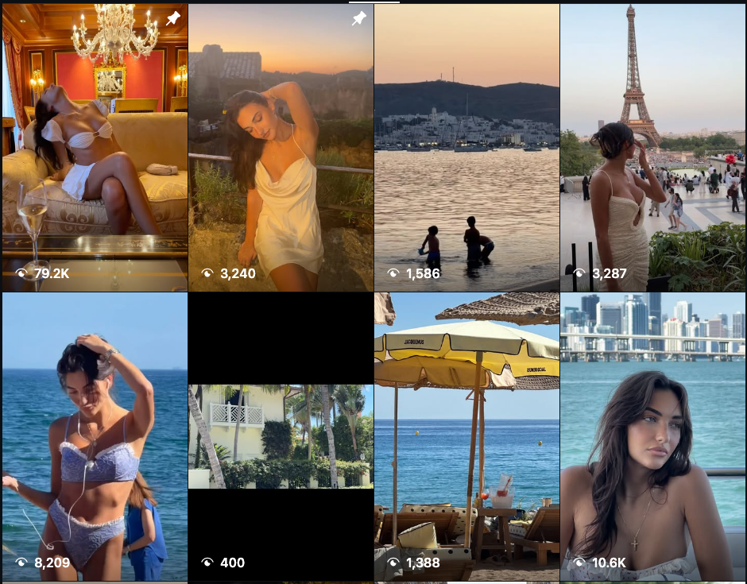
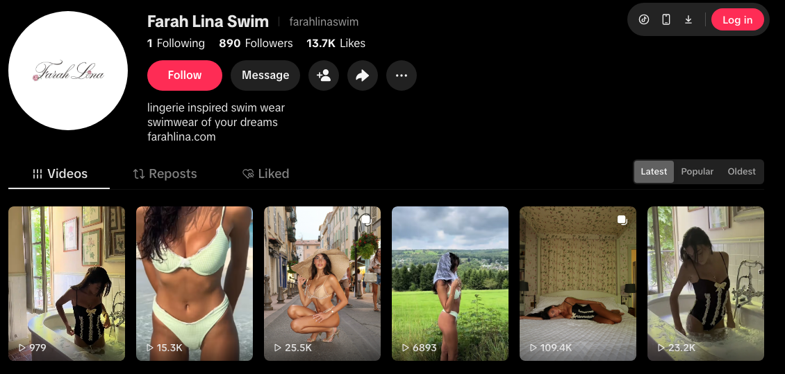
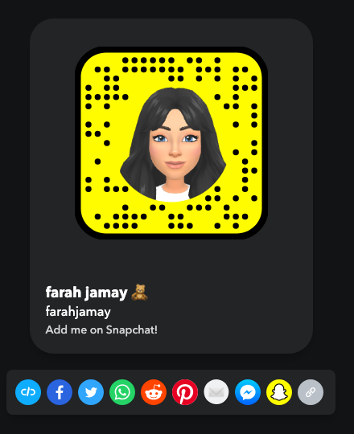

# Creator Platform Audit — Farah Jamay

**Prepared:** October 20, 2026  
**Client:** Farah Jamay (@farahjamay) · designer/founder, Farah Lina Swim  
**Audited by:** ALTR  
**Scope:** Onboarding audit of every discovered platform: Instagram ×2, TikTok ×2, YouTube, Snapchat, farahlina.com. Discovery ran from the provided Instagram handle via link chains and same-handle probes; Famous Birthdays documents only the Instagram. Each platform is graded against its own enforcement system; Snapchat is graded for Snap Star review readiness. External audit — platform-internal analytics are in the client asks (Section 9).

---

## 1. Platform Grade Matrix

Instagram

C+

108K · framing-drift demotion

TikTok

C

Brand alive (890) · personal dormant

YouTube

D

38 subs · 1 video · dormant

Snapchat

F

Snap Star: not started — biggest upside

The portfolio in one sentence

Over 97% of this client's audience sits in a single Instagram account that is currently reach-demoted by its own framing choices, while four other surfaces sit between embryonic and empty — so onboarding is half repair (fix the Instagram staging pattern that's suppressing the core asset) and half expansion (the brand TikTok is already quietly working at 13.7K likes on 890 followers, and her advertiser-clean profile is a textbook Snap Star candidate the moment a public profile exists).

| Platform | Handle | Audience | Status | Grade | Top issue |
|----------|--------|----------|--------|-------|-----------|
| Instagram | @farahjamay | 108K · verified | Suppressed | C+ | Boudoir-coded framing drift |
| Instagram | @farahlinaswim | 1,679 · verified | Active, tiny | C | Lingerie-read product flat-lays |
| TikTok | @farahlinaswim | 890 · 13.7K likes | Nascent, working | B– | Underpowered, not linked from IG |
| TikTok | @farahjamay | 173 · 3 videos | Dormant | D | Unclaimed surface, empty bio |
| YouTube | @farahjamay | 38 subs · 1 video | Dormant | D | Park or commit |
| Snapchat | farahjamay | personal only | No public profile | F* | Snap Star runway not started |
| Web | farahlina.com | — | Clean Shopify | A | None |

*\*Snapchat grade = Snap Star readiness (rubric 07), not a conduct grade — there is nothing to violate because there is no public surface yet.*

---

## 2. Priority Moves

1. **Repair the core asset first:** execute the Oct 20 Instagram audit moves — unpin the boudoir-coded lounge reel, adopt the staging rule (location/activity forward, face-forward covers), unhide like counts, 3 posts/week for the 4–6 week recovery window.
2. **Double down on the TikTok that's already working:** @farahlinaswim's 13.7K likes on 890 followers means TikTok is distributing the content; feed it 4–5 posts/week (watermark-free vertical recuts of existing IG/shoot footage) and put the TikTok link on both Instagram bios.
3. **Start the Snap Star runway now:** convert the personal Snapchat to a Public Profile under her real name, then 90 days of 1 public Story/day + 5–8 Spotlight clips/week before applying. Her clean-conduct, fashion-travel content is exactly the advertiser-clean profile the Star review selects for.
4. **Decide YouTube deliberately:** 38 subscribers neither helps nor hurts — either park it (remove from any links) or commit to Shorts-only cross-posting (never with TikTok watermarks, which are monetization-disqualifying).
5. **Fix the brand commerce imagery everywhere:** on-model, on-location product shots replace nude-lace flat-lays on both @farahlinaswim surfaces; add Instagram Shopping tags.

---

## 3. Instagram — @farahjamay (C+)

Full deep-dive delivered separately (`farahjamay-2026-10-20.pdf`); the findings that drive the portfolio grade:

### HIGH — Suggestive-framing drift is suppressing the portfolio's only real audience

- Recent reels reach **400–10.6K views on 108K followers** vs. 79.2K on the pinned reel — the demotion-band signature.
- Cause is cumulative framing (boudoir-coded sets, chest-centered cutout covers, lingerie-styled swim), not any single post; conduct and links are clean.
- The pinned lounge/champagne reel keeps the account's strongest suggestive signal permanently on top — unpin it, pin the brand-launch founder post.
- Like counts are hidden account-wide: no reach benefit, reads as concealment to brand vetting, and blinds her own analytics.

<figure><figcaption>The Reels tab: 79.2K on the pinned reel vs. 400–10.6K on everything recent — the gap the framing pattern is paying for.</figcaption></figure>

---

## 4. TikTok — @farahlinaswim (B–) and @farahjamay (D)

### The brand TikTok is the portfolio's quiet overperformer

- **@farahlinaswim:** 890 followers, 18 videos, **13.7K likes** — a 15:1 like-to-follower ratio means TikTok's For You feed is distributing this content to non-followers. Proper bio ("lingerie inspired swim wear… farahlina.com").
- **Watch-item (rubric 05):** on-model swim content is fine on TikTok, but the same lingerie-read flat-lays that limit the IG brand account would cap FYF eligibility here too — keep the TikTok grid on-model and on-location.
- **@farahjamay personal TikTok:** 173 followers, 3 videos, literally "No bio yet" — an unclaimed surface. Minimum fix today: bio + link so the handle is held and branded; revive only if she'll feed it.
- Neither Instagram bio links to TikTok — the one platform currently showing organic lift is invisible from the 108K-follower surface.

<figure><figcaption>@farahlinaswim on TikTok: 890 followers, 13.7K likes — the For You feed is already carrying this content; it just isn't being fed or linked.</figcaption></figure>

---

## 5. YouTube — @farahjamay (D)

### Dormant: 38 subscribers, one video

- "through the lens of Farah xx" — a vlog-intent channel that never started. No strikes, no risk; just a dead surface.
- **Decision, not effort:** either park it (unlist from any link surfaces) or commit to a light Shorts pipeline — watermark-free vertical recuts only, since watermarked reposts are monetization-disqualifying (rubric 05). Given team bandwidth, we recommend parking YouTube until the Snap runway is established; swim commerce pays faster on TikTok/Snap/Pinterest than on YouTube.

---

## 6. Snapchat — farahjamay (Snap Star readiness: F — not started)

Only a personal Snapcode page exists ("farah jamay 🧸 — Add me on Snapchat!") — no Public Profile, no public Stories, no Spotlight presence. Nothing to grade for conduct; everything to build. That is the opportunity: Snap Star review selects for exactly her profile — real-name identity, original fashion/travel content, advertiser-clean history — and swim commerce monetizes well there.

**The 90-day runway:** convert to Public Profile under her real name → 1 public Story/day + 5–8 Spotlight clips/week (vertical recuts, no watermarks) → apply once consistency is established. Monetization gate: 50K followers + 15K view-hours/28d (≥3K from Spotlight).

<figure><figcaption>The entire current Snapchat presence: a personal add-me page. For Snap Star purposes, a blank slate.</figcaption></figure>

| Axis | Standard | Client today | Verdict |
|------|----------|--------------|---------|
| Scale | ~50K subs; monetization 50K + 15K view-hrs/28d | No public profile | FAIL |
| Consistency | 25+ public posts/mo, near-daily | No public posting | FAIL |
| Identity | Real name/brand, coherent theme | Real name in place | PASS |
| Originality | No watermarked reposts, no full-AI | Original content exists (from IG library) | PASS |
| Advertiser-clean | Stricter than guidelines | Clean history; swim content passes when staged per the IG rule | PASS |

*Three of five axes already pass — the two failures are both "hasn't started," which is the easiest F in this business to fix.*

---

## 7. Routing Map

Where each content type lives

<ul>
<li>Founder story / BTS → IG personal + TikTok brand + Snap Stories</li>
<li>On-model swim (staged clean) → everywhere</li>
<li>Product commerce → IG Shopping tags + farahlina.com + Pinterest (launch)</li>
<li>Daily casual → Snapchat public Stories (the Star runway)</li>
</ul>

Cut / never create

<ul>
<li>Boudoir-coded staging — on any platform (Spotlight's bar is strictest)</li>
<li>Lingerie-read flat-lays on social commerce surfaces</li>
<li>Watermarked cross-posts to Shorts/Spotlight</li>
<li>Dead surfaces in bios (YouTube until revived)</li>
</ul>

No cross-contamination exists in this portfolio — a rarity among our clients. The funnel problem is absence, not poison: the working TikTok is unlinked, and the highest-upside platform has no public surface.

---

## 8. Action Plan

**Today:**
1. Instagram repairs per the standalone audit (unpin, staging rule, unhide likes).
2. Claim the personal TikTok: bio + farahlina.com link; both IG bios gain the TikTok link.
3. Convert Snapchat to a Public Profile.

**This week:**
1. Build the recut pipeline: every shoot produces vertical, watermark-free cuts for TikTok + Spotlight.
2. @farahlinaswim (both platforms): replace flat-lay grid rows with on-model product; enable IG Shopping tags.
3. Account Status screenshots on both IG accounts and TikTok.

**Ongoing (90-day runway):**
1. Cadence: IG 3/week · TikTok brand 4–5/week · Snap 1 Story/day + 5–8 Spotlight/week.
2. Pinterest brand launch (Shopify catalog sync).
3. Apply for Snap Star after 90 days of consistency; revisit YouTube after that.

---

## 9. What We Need From the Client

1. **Instagram** (both accounts): Settings → Account Status screenshots; Insights → Reach non-follower % (90 days); why likes are hidden.
2. **TikTok** (both): any violation notices; analytics screenshots (views, FYF %).
3. **Snapchat:** confirm she controls the farahjamay handle; current friend count; willingness to run daily public Stories (the runway lives or dies on this).
4. **Confirm ownership** of TikTok @farahjamay and YouTube @farahjamay (discovered by handle-probe, not from her links).
5. Pre-order timeline for the chateau collection — the IG recovery window and TikTok push should be sequenced ahead of it.

**Re-audit at 30 days:** IG staging rule visible and views climbing; TikTok linked and fed; Snap Public Profile live with 25+ public posts.

---
*This audit assesses compliance with each platform's published policies as understood at the audit date. Enforcement and program acceptance are partly discretionary; no compliance change guarantees reach or Snap Star acceptance. All recommendations aim at genuine compliance — we do not advise disguising violating content.*
