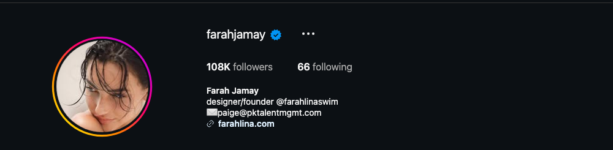
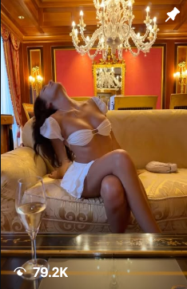
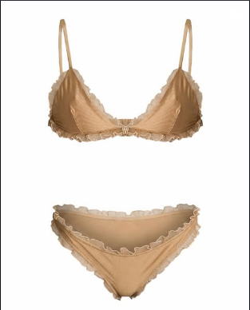

# Instagram Account Audit — @farahjamay

**Prepared:** October 20, 2026  
**Account:** https://www.instagram.com/farahjamay/ (Farah Jamay)  
**Audited by:** ALTR  
**Scope:** Public profile, Reels tab with view counts, 12 recent posts, the @farahlinaswim brand account, and the farahlina.com link chain. Like counts are hidden on every post, so views are the public reach signal.

---

## 1. Snapshot

Risk grade

C+

Demotion drift, business exposure

Followers

108K

Verified · talent-managed

Recent reel views

0.4–10.6K

vs. 79.2K on the pinned reel

Brand account

1,679

@farahlinaswim followers

0 CRITICAL 2 HIGH 3 MEDIUM 2 LOW

The situation in one sentence

There is nothing scandalous on this account — no funnels, no adult links, clean captions — but the cumulative framing pattern (boudoir-coded settings, lace and cutout styling, lingerie-styled swim) has drifted the account into Instagram's suggestive-content demotion band, recent reels are reaching 0.4–10% of what the pinned reel proves is possible, and the swimwear business that depends entirely on this account's reach is feeling it first.

Pinned — lounge/champagne bikini reel

79.2K

Miami skyline reel

10.6K

Lavender lace swim reel

8,209

Paris / Eiffel reel

3,287

Pinned — sunset slip dress

3,240

Harbor swim reel

1,586

Beach club reel

1,388

Villa reel

400

Views per reel, Reels tab, Oct 20 2026 · 108K followers · recent reels reach 0.4–10% of followers. Like counts are hidden account-wide, so this is the only public performance signal.

---

## 2. The Three Moves

**Move 1 — shift the framing, not the wardrobe:** swim content is fine; *boudoir-coded* swim content is what demotes. Beach, boat, pool, street — yes. Lounge-recline with champagne, bedroom mirrors, chest-centered crops and covers — that's the pattern Instagram's classifier scores, and it's the difference between the 79.2K reel's distribution era and the 400-view reel.

**Move 2 — make the founder story the spine:** the April brand-launch post ("building something from a feeling…") is the most recommendable content this account has — designer-at-work, fittings, fabric, the chateau shoot BTS. It sells the product harder than another bikini portrait, and the algorithm actively distributes it.

**Move 3 — stop hiding the like counts:** hidden likes on every post does nothing for reach, signals "something to hide" to brand partners doing vetting, and removes her own ability to see what's working. Unhide once the mix shift starts.

<figure><figcaption>Verified, 108K, talent-managed, clean bio: designer/founder @farahlinaswim, management email, farahlina.com. The hygiene is genuinely good — the issue is framing, not conduct.</figcaption></figure>

---

## 3. Findings

### HIGH — Cumulative suggestive-framing drift is suppressing reach

- **The pattern, not any single post:** the pinned reel (lounge recline, champagne, bikini — boudoir-coded setting), lace/sheer looks with chest-centered cutouts, and lingerie-styled swim shots. Each is individually allowed; together they form the "sexually suggestive" recommendation-exclusion pattern that caps non-follower distribution account-wide.
- **The evidence:** recent reels at 400–10.6K views on 108K followers, against the pinned reel's 79.2K. A healthy fashion account this size shows regular follower-count-beating reels.
- **Fix (adjust, not reinvent):** same wardrobe, different staging — activity and location forward, face-forward cover frames, wide shots over body-crop inserts. The Mykonos/Paris travel framing already in the grid is the compliant version; make it the default.

<figure><figcaption>The pinned reel: lounge-recline + champagne + bikini. Highest views on the account (79.2K) — and the exact setting+styling combination rubric 01 flags as boudoir-coded. Pinning it keeps the account's strongest suggestive signal permanently on top.</figcaption></figure>

### HIGH — The entire business depends on a suppressed account

- **The funnel:** farahlina.com (clean Shopify store) and @farahlinaswim (**1,679 followers**) have no audience of their own — every pre-order depends on @farahjamay's reach, which is exactly what's suppressed.
- **The brand account compounds it:** product flat-lays of nude lace bra-and-brief sets are visually indistinguishable from lingerie commerce to a classifier — "lingerie-inspired" is the brand language, but lingerie-read product imagery inherits lingerie-tier recommendation limits. On-model, on-location product shots read as swimwear; flat-lays read as underwear.
- **Fix:** shoot product on-model at the beach/pool as the default grid content for @farahlinaswim; use Instagram Shopping product tags (tagged commerce gets distribution surfaces organic posts don't); grow a platform the brand owns (see Section 6).

<figure><figcaption>@farahlinaswim product imagery: a nude lace two-piece flat-lay — accurate to the "lingerie-inspired" brand, and exactly what a classifier files under lingerie commerce.</figcaption></figure>

### MEDIUM — Three compounding patterns

- **Hidden like counts on every post** — no reach benefit, reads as concealment to vetting brand partners, and blinds her own performance analysis. Unhide with the mix shift.
- **Posting cadence** — roughly one or two posts a month gives the ranking system almost nothing to redistribute; recovery from demotion requires consistent clean posting (3+ per week during the recovery window).
- **Pinned-post strategy** — the strongest suggestive signal (lounge reel) is pinned first, so every review and every new visitor starts there. Pin the founder/brand-launch content instead.

### LOW — What's healthy

- Verified; genuinely clean link chain (farahlina.com → Shopify, no aggregators); professional management contact in bio; no third-party funnels, codes, or platform links; captions are brand-safe. No removal-layer content anywhere in the reviewed grid. This is a framing problem, not a conduct problem — the most fixable kind.

---

## 4. Content Findings

| # | Post (date) | Issue | Severity | Action |
|---|-------------|-------|----------|--------|
| P | Pinned reel — lounge/champagne bikini (79.2K views) | Boudoir-coded setting; pinned on top | HIGH | Unpin; replace with founder story |
| 1 | Oct 19 post — night lace top | Sheer/lace chest-centered styling | MEDIUM | Keep; prefer wider crops next time |
| 2 | Oct 3 reel — harbor | Clean travel content | LOW | Keep — the model |
| 3 | Sep 12 post — "magic in unfamiliar places" | Clean | LOW | Keep |
| 4 | Sep 3 post — "mykonos mwah" (lace cutout dress) | Cutout framing on cover | MEDIUM | Keep; face-forward cover |
| 5 | Jul 27 post — "another year, softly" | Clean | LOW | Keep |
| 6 | Apr 27 post — brand launch letter | Clean; the best content on the account | LOW | Pin this |
| 7–12 | Apr–Jun travel/swim set | Mixed framing per above | LOW–MED | Apply the staging rule |

---

## 5. Two Framings, One Wardrobe

What distributes — make default

<ul>
<li>Travel/location-forward swim — Miami 10.6K · best recents</li>
<li>Founder/designer story (brand-launch post)</li>
<li>Face-forward covers, wide shots, activity in frame</li>
<li>On-model product at the beach (for the brand account)</li>
</ul>

What demotes — retire

<ul>
<li>Boudoir-coded settings (lounge recline, champagne, bedroom)</li>
<li>Chest-centered cutout crops as cover frames</li>
<li>Lingerie-read product flat-lays</li>
<li>Hidden likes + 1/month cadence starving the algorithm</li>
</ul>

Same designer, same swimwear, same aesthetic — staged one way it reads as a luxury travel brand, staged the other it reads as boudoir content. The 79.2K-vs-400 spread is the platform pricing that difference.

---

## 6. Cross-Platform Exposure

| Platform | Audience | What we found | Risk on that platform | Move |
|----------|----------|---------------|----------------------|------|
| IG @farahlinaswim | 1,679 | Verified brand account; lingerie-read flat-lays; "pre-order" model | Commerce account inherits lingerie-tier recommendation limits | On-model product shots; Shopping tags |
| farahlina.com | — | Clean Shopify store, shop.app only | None | Keep as-is |
| Other platforms | — | **None exist** — no TikTok, Pinterest, or YouTube presence found | Single-point-of-failure: one demoted IG account carries the whole business | Launch Pinterest + TikTok for the brand |

**Routing rule for this client:** swimwear commerce is one of the highest-ROI categories on **Pinterest** (commerce-intent audience, far gentler suggestive-content thresholds for swim) and performs on **TikTok** via founder-story content. Right now 100% of brand discovery rides on one suppressed Instagram account — the diversification is the business fix, not just the compliance fix.

---

## 7. Action Plan

**Today:**
1. Unpin the lounge reel; pin the brand-launch founder post.
2. Define the staging rule for future shoots: location and activity forward, face-forward covers, no boudoir-coded sets.

**This week:**
1. Unhide like counts.
2. @farahlinaswim: replace the top grid row with on-model beach product shots; set up Instagram Shopping product tags.
3. **Settings → Account Status** on both accounts — screenshot both panels; appeal nothing yet.

**Ongoing:**
1. Cadence: 3 posts/week on the personal account during the 4–6 week recovery window — travel, founder story, on-location swim.
2. Launch the brand on Pinterest (catalog sync from Shopify is nearly free) and begin founder-story TikTok.
3. Re-shoot product imagery on-model as the default for all commerce surfaces.

---

## 8. What We Need From the Client

1. **Settings → Account Status** — both panels, both accounts.
2. **Insights → Reach → non-follower %** for 90 days on @farahjamay (we want the date the slide started), and view counts on the like-hidden posts.
3. Why likes were hidden (advice from management, or personal choice) — it changes how we frame the unhide.
4. The pre-order timeline for the chateau collection — the recovery window should be sequenced ahead of the launch push.

**Re-audit at 30 days:** staging rule visible in new posts, likes unhidden, brand-account grid reshaped, and recent-reel views climbing off the sub-2K floor.

---
*This audit assesses compliance with Meta's published Community Standards and Recommendation Guidelines as understood at the audit date. Enforcement is partly discretionary; no compliance change guarantees restored reach. All recommendations aim at genuine compliance — we do not advise disguising violating content, which converts reach problems into account-loss problems.*
