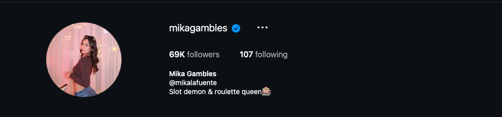
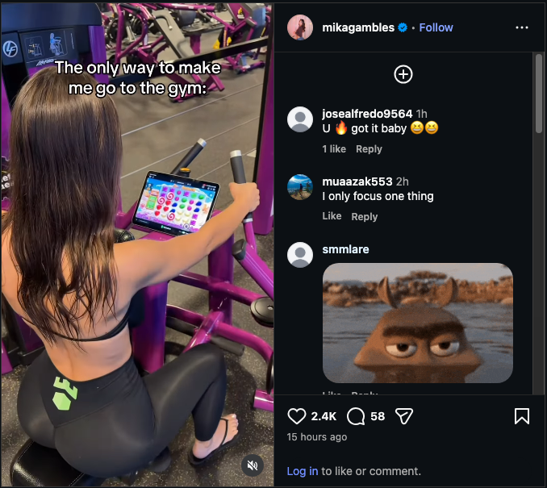

# Instagram Account Audit — @mikagambles

**Prepared:** September 22, 2026  
**Account:** https://www.instagram.com/mikagambles/  
**Audited by:** ALTR  
**Scope:** Public profile, Reels tab with view counts, 12 recent posts (8 with full caption/engagement data), comment sampling, and the cross-link relationship with @mikalafuente. Companion report: `mikalafuente-2026-09-22`.

---

## 1. Snapshot

Risk grade

C

Structural, not violations — yet

Followers

69K

Verified · posting near-daily

Reel views

39–115K

Regularly exceeds follower count

Content mix

~100%

Casino-floor gambling content

0 CRITICAL 2 HIGH 4 MEDIUM 1 LOW

The situation in one sentence

This account is doing unusually well for its category — recommendation distribution is still ACTIVE (reels regularly out-reach the follower count) because it has so far avoided the fatal moves (no casino referral codes, no bonus links, no sponsor promos on-platform) — but it is one sponsorship integration away from the enforcement cliff, and its biggest current risk is what it does to the 1.3M-follower main account that funnels into it.

"Well my…" casino reel

115K

Roulette table reel

72.6K

"I love roulette"

68.7K

Gym / slots reel

57K

Slots reaction

56.4K

Blackjack "PAYS 2 TO…"

39.4K

"I have $300"

9,168

"So here's…" casino walk

4,397

Views per reel, Reels tab, Sept 22 2026 · 69K followers · most reels exceed follower count = non-follower distribution is still on. The account has reach to lose.

---

## 2. The Three Moves

**Move 1 — protect the reach it still has:** keep the one rule that's working — **no casino codes, no bonus links, no sponsor integrations on Instagram, ever**. The moment a Gamdom code or "play where I play" link appears (the audience is already asking about Gamdom streams), this becomes an unpermitted gambling-promotion account and follows the standard collapse: strikes, reach death, disable risk.

**Move 2 — de-couple from the main account:** remove "@mikalafuente" from this bio and "@mikagambles" from the main account's bio (detail in the companion report). The alt should be discoverable by intent, not funneled a 1.3M mixed-age audience.

**Move 3 — build the off-ramp now:** age-gate everything that can be gated, and diversify the grid (the gym reel formula — casino-personality content without a casino — already outperforms half the casino reels at 57K views).

<figure><figcaption>Verified, 69K, "Slot demon &amp; roulette queen🎰" — and the @mikalafuente cross-link that ties a 1.3M-follower account to this one.</figcaption></figure>

---

## 3. Findings

### HIGH — The account's entire category is age-gated and non-recommendable by policy

- **What the grid is:** wall-to-wall casino-floor content — roulette, blackjack, slots, cash-in-hand, jackpot jokes. Meta's Recommendation Guidelines exclude gambling content from Explore/Reels distribution and it is filtered from under-18 audiences entirely.
- **The paradox:** distribution is currently strong (115K peaks). That means classifiers haven't fully caught the account yet — enforcement in this category is rolling out continuously, and every comparable account we've audited eventually hits the ceiling. Treat today's reach as borrowed, not owned.
- **Fix:** diversify now from strength, not later from suppression: keep the casino-personality voice, widen the settings (the gym reel proves the formula travels). Target a grid that's no more than half casino-floor within 60 days.

<figure><figcaption>The grid: every tile but one is casino floor. As a category, this content is excluded from recommendation and from all under-18 delivery.</figcaption></figure>

### HIGH — One sponsorship away from the cliff

- **What we found:** the audience already treats her as a gambling streamer ("Are u gonn stream gamdom?"); the cohort she's grouped with (@highstakeshottie, @bettinboop) runs crypto-casino sponsorships; and the account's growth makes a sponsor offer inevitable if it hasn't landed already.
- **The line that must not be crossed on Instagram:** codes, bonus links, "play where I play," casino tags in bio, or sponsor watermarks in reels. Real-money gambling promotion without Meta's written permission is removal/strike-layer — it is the single move that converts this account from "demoted category" to "enforcement target," and it's the exact mistake that killed the reach of comparable accounts we've audited.
- **Fix:** if/when a sponsor deal happens, it lives on Kick/stream platforms and their clip channels only. Instagram stays clean: personality, reactions, lifestyle — zero commercial gambling ties.

### MEDIUM — Four patterns to manage

- **Empty captions on most posts** reads as clip-dump behavior and wastes ranking signal; one personality line per reel fixes it.
- **Sports-betting engagement bait** ("Which two teams should I pick for the first week?👀" — 158 comments) crosses from casino-trip content into betting-solicitation territory; keep picks content off IG.
- **Loss-glamorizing jokes** ("I love walking past the jackpot screen after loosing – said nobody never," "I have $300") — the responsible-gambling optics matter for brand deals and for how reviewers read the account.
- **Gambling normalized outside the casino** (slots app at the gym) — funny, but it extends the gambling read to every post; keep non-casino reels genuinely non-gambling so they're recommendable.

<figure><figcaption>Newest reel (Sep 21): "The only way to make me go to the gym" — slots on the bike tablet. The non-casino content that could diversify the grid is still coded as gambling.</figcaption></figure>

### LOW — Hygiene

- Bio is clean of links (good — keep it that way); 107 following is healthy; verified badge intact. No evasion spellings, no funnel links, no watermarks detected — genuinely better hygiene than most accounts in this niche.

---

## 4. Content Findings

| # | Post (date) | Issue | Severity | Action |
|---|-------------|-------|----------|--------|
| 1 | Sep 21 reel — gym/slots (2.4K likes, 57K views) | Gambling coded into non-casino content | MEDIUM | Keep format; drop the slots bit next time |
| 2 | Sep 20 reel — casino floor (2.2K likes) | Category content, no caption | MEDIUM | Add personality caption |
| 3 | Sep 19 reel — casino floor (2.0K likes) | Category content | LOW | Keep within mix target |
| 4 | Sep 18 reel — casino floor (2.3K likes) | Category content | LOW | Keep within mix target |
| 5 | Sep 15 reel — "Where should I go next?" (1.3K likes) | Casino-tour framing; fine | LOW | Keep |
| 6 | Sep 14 reel — casino floor (1.6K likes) | Category content | LOW | Keep within mix target |
| 7 | Sep 7 reel — "Which two teams should I pick?👀" (2.9K likes, 158 comments) | Betting-picks engagement bait | MEDIUM | No more picks content on IG |
| 8 | Sep 4 reel — casino floor (1.4K likes) | Category content | LOW | Keep within mix target |

*Posts 9–12 (Aug 28–Sep 1) match the same casino-floor pattern from grid review; no codes or sponsor marks detected anywhere — the account's single most important trait to preserve.*

---

## 5. Where This Account Is vs. Where the Niche Ends Up

What it's doing right — rare in this niche

<ul>
<li>No referral codes or bonus links anywhere — 0 found</li>
<li>Reach still on — reels out-reach followers</li>
<li>No evasion spellings, no funnel pages</li>
<li>Personality formula travels (gym reel 57K)</li>
</ul>

What ends these accounts — pre-empt it

<ul>
<li>Sponsor code/link lands on IG → strike layer</li>
<li>100% casino grid → category ceiling as enforcement catches up</li>
<li>Betting-picks bait → solicitation reads</li>
<li>1.3M mixed-age funnel from the main account</li>
</ul>

This is the rare audit where the job is **prevention**: the account is pre-cliff, not post-cliff. Every comparable account we've audited waited until after the collapse to make these changes.

---

## 6. Action Plan

**Today:**
1. Agree the hard rule in writing with any sponsor: no codes, links, tags, or watermarks on Instagram — stream-platform only.
2. Remove "@mikalafuente" from this bio (and the reverse link on the main account — see companion report).

**This week:**
1. Start captioning every reel with one personality line.
2. Retire the betting-picks format on IG.
3. Plan the mix shift: 3–4 casino reels + 3–4 non-casino personality reels per week, targeting ≤50% casino grid in 60 days.

**Ongoing:**
1. Keep loss-content self-aware rather than glamorizing; skip "how much I lost" as a recurring bit.
2. Watch Account Status monthly — first sign of "can't be recommended" entries means the category ceiling is arriving; accelerate the mix shift.

---

## 7. What We Need From the Client

1. **Settings → Account Status** — both panels (we expect this one to be clean today; we want the baseline).
2. **Insights → Audience age split** — how much of the 69K is under 25/under 18-adjacent matters for the gating conversation.
3. Any existing sponsor discussions or contracts (Gamdom or otherwise) — we need to review the Instagram-facing terms before anything goes live.
4. Whether the account runs on the same devices/business manager as @mikalafuente.

**Re-audit at 30 days:** confirm the mix shift started, bio de-coupling done, Account Status still clean.

---
*This audit assesses compliance with Meta's published Community Standards and Recommendation Guidelines as understood at the audit date. Enforcement is partly discretionary; no compliance change guarantees continued reach. All recommendations aim at genuine compliance — we do not advise disguising violating content, which converts reach problems into account-loss problems.*
