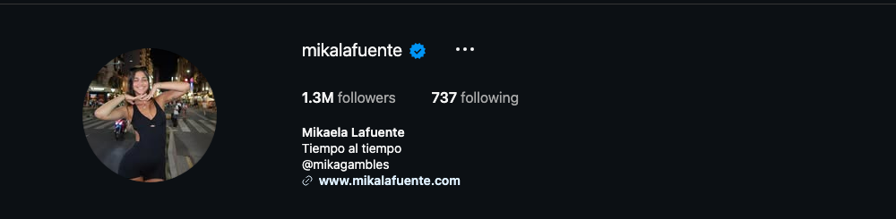
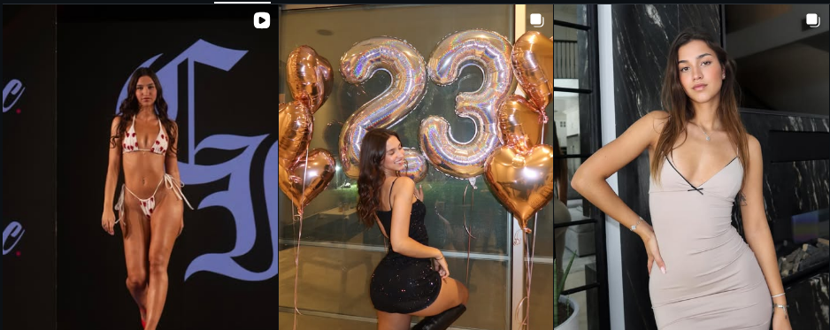

# Instagram Account Audit — @mikalafuente

**Prepared:** September 22, 2026  
**Account:** https://www.instagram.com/mikalafuente/  
**Audited by:** ALTR  
**Scope:** Public profile, bio-link chain (mikalafuente.com), and recent grid content (12 posts with caption/engagement data). Companion report: `mikagambles-2026-09-22`.

---

## 1. Snapshot

Risk grade

B+

Healthy; one structural fix

Followers

1.3M

Verified · following 737

Typical likes

62–172K

5–13% of audience — strong

Reach status

Full

No suppression indicators

0 CRITICAL 1 HIGH 2 MEDIUM 2 LOW

The situation in one sentence

This is a healthy, fully-distributed 1.3M account with brand-safe model/lifestyle content and engagement most accounts dream about — its one meaningful exposure is the "@mikagambles" line in the bio, which points a mixed-age megaphone at a gambling account and ties the two accounts' fates together.

---

## 2. The One Move

**Remove "@mikagambles" from the bio** (and the reciprocal "@mikalafuente" from the alt's bio).

Why it matters more than it looks:
- A 1.3M audience includes a large under-18 segment that Meta actively walls off from gambling content; a main-bio handle link is a standing invitation across that wall.
- Cross-linked accounts share fate in review: if the alt ever takes gambling-promotion strikes (one sponsor code away — see companion report), the bio link makes this account the funnel that fed it.
- Discovery doesn't need the bio: the alt is already growing on its own distribution (39–115K views/reel). Occasional story mentions to an age-gated audience do the same job without the permanent public tie.

<figure><figcaption>The bio at audit time: "Tiempo al tiempo / @mikagambles / mikalafuente.com" — the gambling alt advertised on a 1.3M mixed-age surface.</figcaption></figure>

---

## 3. Findings

### HIGH — Bio funnel from a 1.3M mixed-age audience to a gambling account

- Covered in Section 2 — this is the report's only significant finding, and it's a five-minute fix. Everything else below is hygiene.

### MEDIUM — Two watch-items

- **Keep the accounts editorially separate:** no casino clips, jackpot stories, or gambling jokes on this account — the moment gambling content appears here, the 1.3M account inherits the alt's category ceiling. Today the grid is clean (fashion, birthdays, travel, brand work); keep it that way.
- **Suggestive-framing drift:** a minority of posts lean swimwear/body-framed. Engagement says the audience is here for personality and aesthetics; nothing currently crosses into demotion territory, but keep covers face-forward and avoid body-part-centered crops as the algorithm keeps tightening around adult-adjacent framing.

<figure><figcaption>Recent grid: brand-safe model/lifestyle content — runway, birthday, editorial. This is what full distribution looks like; protect it.</figcaption></figure>

### LOW — Hygiene

- **Alcohol-adjacent party content** (🍷 reels): fine for this audience, teen-filtered automatically; nothing to change.
- **mikalafuente.com** is a clean personal site with no risky outbound links — good. Keep the bio link pointing there rather than to any aggregator.

---

## 4. Content Findings

| # | Post (date) | Issue | Severity | Action |
|---|-------------|-------|----------|--------|
| 1 | Sep 17 reel — "❤️🍷💌🪩" (62K likes) | Party/alcohol-adjacent; fine | LOW | Keep |
| 2 | Jun 2025 — birthday recap (64K likes) | Clean | LOW | Keep |
| 3 | Sep 2024 — "Very classy very demure" (117K likes) | Clean | LOW | Keep |
| 4 | Jun 2024 — birthday (172K likes) | Clean; best performer | LOW | Keep |
| 5 | May 2024 — Capri dump (115K likes) | Clean | LOW | Keep |
| 6 | May 2024 — football box (134K likes) | Clean | LOW | Keep |

*The remaining grid follows the same pattern: high-performing, brand-safe lifestyle content with zero policy flags. This table is short because the account is genuinely clean.*

---

## 5. The Two-Account Picture

This account — protect

<ul>
<li>Full distribution — 62–172K likes/post</li>
<li>Brand-safe grid; verified; clean link chain</li>
<li>Sponsor-friendly surface worth real money</li>
</ul>

The tie to the alt — cut

<ul>
<li>Bio funnels minors-inclusive 1.3M to casino content</li>
<li>Shared fate if the alt takes sponsor-promo strikes</li>
<li>Zero upside: the alt already reaches 39–115K/reel on its own</li>
</ul>

One sentence of strategy: this account is the business; the alt is the hobby that could cost the business — keep them structurally separate and both can run.

---

## 6. Action Plan

**Today:** remove "@mikagambles" from the bio; have the alt drop "@mikalafuente" from its bio the same day.

**This week:** agree the editorial wall (no gambling content on this account, no cross-posting); review any story highlights for casino clips.

**Ongoing:** keep covers face-forward on swimwear content; re-check the link chain whenever the website changes; monthly Account Status glance for baseline.

---

## 7. What We Need From the Client

1. **Settings → Account Status** — both panels (expected clean; we want the baseline screenshot).
2. **Insights → Audience age split** — sizes the minor-audience exposure that motivated the bio fix.
3. Confirmation of any brand contracts with morality/brand-safety clauses (the gambling tie is the kind of thing those clauses catch).

**Re-audit at 30 days:** confirm de-coupling done and grid still clean — this one should be a two-line check.

---
*This audit assesses compliance with Meta's published Community Standards and Recommendation Guidelines as understood at the audit date. Enforcement is partly discretionary; no compliance change guarantees continued reach. All recommendations aim at genuine compliance — we do not advise disguising violating content, which converts reach problems into account-loss problems.*
