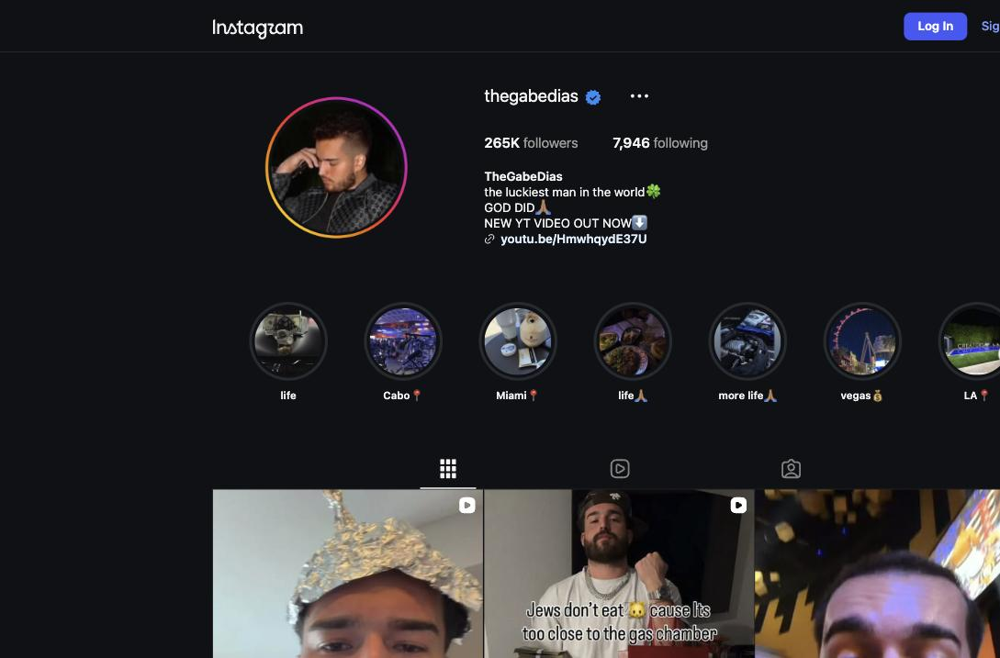
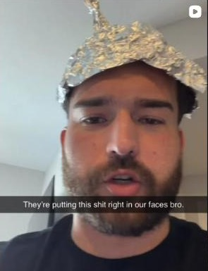
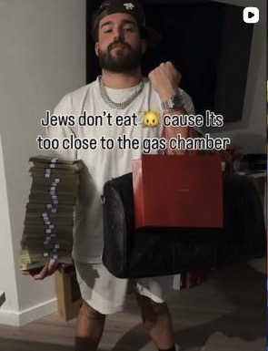
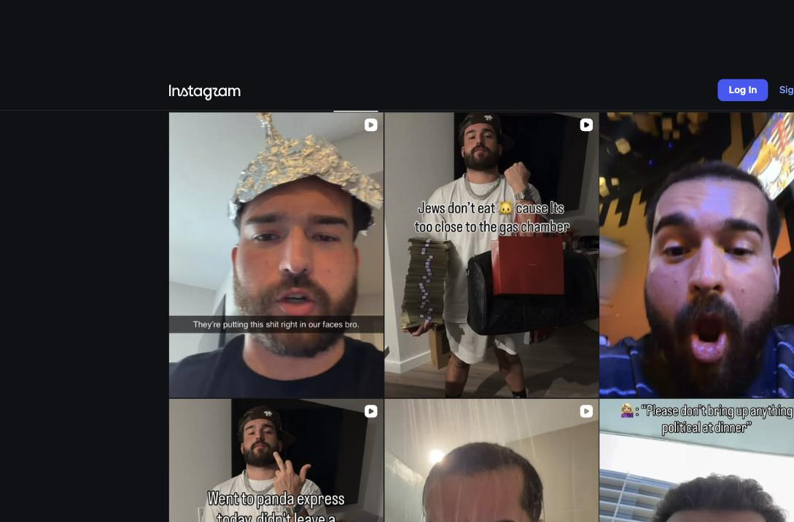

# Instagram Account Audit — @thegabedias

**Prepared:** September 12, 2026  
**Account:** https://www.instagram.com/thegabedias/ (verified, 265K followers, following 7,946)  
**Audited by:** ALTR  
**Scope:** Public profile, bio-link destination, and recent grid content (15 posts reviewed visually; captions/comments/engagement pulled for the 6 most recent posts accessible logged-out). Like counts are hidden on several posts; stories/highlights content, view counts, and Account Status internals are outside external view — Section 6 covers what the client must pull.

---

## 1. Executive Summary

**Overall risk grade: F**  
**Primary problem in one sentence:** The account's signature "shock flex" format currently includes at least two standing posts whose text overlays are outright hate speech (a Holocaust gas-chamber joke and an anti-Asian slur paired with a Pearl Harbor joke) — removal-and-strike-layer violations that put the account itself, its verification, and every brand deal at risk, on top of an already-collapsed content funnel.  
**Is account-level recommendation ineligibility likely active?** Almost certainly, and it's the smaller problem. Where like counts are visible, reels earn 1.6K–2.5K likes on 265K followers (~0.6–0.9%) with 50–60 comments; like counts are hidden on the edgiest posts. But this account's exposure is strikes, not just reach.

This audit has a different shape than most: the majority of the recent grid is genuinely workable comedy — game bits ("SILENT LIBRARY PT.1"), gym bits ("Day 0 of locking in!"), shopping and barber bits — that is compliant, recommendable, and where the audience's positive engagement visibly lives. Layered on top of it are (a) hate-speech shock overlays that are strike inventory sitting in public view, and (b) an undisclosed referral-code promotion for "Trench," a crypto/memecoin trading app, wrapped in "FULL PORT" (go all-in) messaging. Those two layers are what's getting the account flagged, and neither is fixable by rewording — they have to stop. The comedy underneath them doesn't.

**Findings at a glance:** 2 Critical · 3 High · 4 Medium · 1 Low

<figure><figcaption>Profile at audit time: verified, 265K followers, following 7,946. Bio claims "NEW YT VIDEO OUT NOW⬇️" — the link goes to an 11-month-old video (see Section 2). Highlights (life, Cabo, Miami, Vegas, LA) are clean lifestyle content.</figcaption></figure>

---

## 2. Account-Level Findings

### HIGH — The "shock flex" format is generating strike-layer violations, not just demotions
- **What we found:** The account's recurring format — luxury flex visuals (cash stacks, Cartier, designer bags) with an outrageous overlay line — currently escalates into slurs and atrocity jokes (see the two CRITICAL items in Section 3). The audience knows the reference points (a commenter: "Did you download the brickboy Dior update… you sound and act exactly like him").
- **Policy tripped:** Hate Speech / Dangerous Organizations & Individuals (Holocaust mocking is explicitly enforceable) — Community Standards, **removal + strike layer**. This is the layer that disables accounts, removes verification, and kills monetization eligibility; it also explains flags that arrive "randomly" — these posts get reported in bursts every time a clip travels.
- **Why "edgy comedy" doesn't protect it:** Meta's hate-speech policy has no satire carve-out a classifier or first-line reviewer will apply; slur + protected group + atrocity reference is a near-automatic action. Repetition converts individual removals into account-level restriction and eventual disable — for a verified account, that also risks the badge.
- **Fix options:** *Adjust:* none — no rewording of a gas-chamber joke is compliant. *Rework:* keep the exact same format (flex + absurd overlay) with absurdist, non-protected-group targets — self-deprecation, wealth absurdity, roommate feuds; the format is fine, the targets are the violation. *Remove:* delete (not archive) both CRITICAL posts today.
- **Our recommendation:** Delete today + hard rule going forward: no slurs, no protected-group jokes, no atrocity references, in overlays, audio, or captions. This is the single change that stops the flagging cycle.

### HIGH — Undisclosed crypto-trading promotion ("Trench") with all-in messaging
- **What we found:** The Sep 4 reel is captioned "LIFE IS FREE WHEN U FULL PORT" (full port = putting your entire portfolio into one trade) and the 4-day-old money-flex reel is captioned "AINT NOTHIN GONNA STOP ME FROM GETTIN PAID"; comments on both confirm an active referral funnel for the Trench trading app ("I signed up for Trench with your code," "I used code Gabe on trench check dms," "What's a good <100 trade"). No paid-partnership label on any of it.
- **Policy tripped:** Meta restricts promotion of cryptocurrency trading products — eligibility requires written permission that organic referral-code promos never have; unlabeled paid promotion also violates branded-content policy. Separately, "full port" messaging to a general audience is the kind of financial-harm framing that draws both platform action and FTC attention (undisclosed material connection + implied earnings claims).
- **Why it matters:** Combined with the hate overlays on the same posts, this reads to a reviewer as a scam-adjacent account pattern: shock content + cash flexing + "use my code." That pattern gets accounts disabled outright, not demoted.
- **Fix options:** *Adjust:* if any sponsorship continues, it needs the paid-partnership label, no earnings implications, no "full port" framing — and even then, an unregistered memecoin platform will not survive review. *Remove:* end the Trench promos on Instagram entirely; keep trading content, if any, on platforms whose rules allow it with proper disclosure.
- **Our recommendation:** Remove. This funnel earns pennies against the account it's endangering.

### HIGH — Broken bio funnel
- **What we found:** Bio says "NEW YT VIDEO OUT NOW⬇️" — the link (youtu.be/HmwhqydE37U) is an **11-month-old** video ("CUTTING ON CUT WATERS – LEANER BY THE DAY EP.1", 1K views) on a YouTube channel with **86 subscribers**.
- **Why it matters:** No policy issue — but the account's only bio CTA is stale by nearly a year, and the 265K→86 audience conversion says the funnel has never worked. Same lesson as every audit: reach is being spent pointing at nothing.
- **Fix:** Replace with a current, evergreen destination (channel page, not a single video), or drop the link until the YouTube relaunch is real.

### MEDIUM — Conspiracy-bit format
- The tinfoil-hat reel ("They're putting this shit right in our faces bro.") is satire, but conspiracy-formatted content is scored for recommendation demotion regardless of intent (classifiers key the visual + phrase pattern, not the joke). Keep the bit clearly absurd (props, punchline in-frame) or expect these reels to underperform.

<figure><figcaption>The tinfoil-hat conspiracy bit — satirical, but formatted exactly like the content class Instagram demotes.</figcaption></figure>

### MEDIUM — Comment section is unmoderated
- Recent posts carry duplicate scam-bot walls (the same "super villains" scam comment posted 4x), referral beggars, gambling/forex accounts, and slurs from commenters. An unmoderated comment section both feeds the classifier's read of the account and repels brands.
- **Fix:** Hidden Words on (including custom list: slurs, "code," "check dms," "signed up with your"), delete/report the bot walls weekly, restrict repeat offenders. 20 minutes to set up.

### MEDIUM — Following 7,946 at 265K followers
- Legacy follow-back growth signal; batch-unfollow to under ~1,000 over the next month. No automation tools while doing it.

### MEDIUM — Hidden like counts on the edgiest posts
- Like counts are hidden exactly where the content is most inflammatory. That's the client managing optics instead of the problem — and it does nothing for reach or enforcement. Unhide once the content mix is fixed; public engagement recovering is also the client's own recovery signal.

### LOW — Alcohol-forward series branding
- The bio-linked "Cutting on Cut Waters" series (drinking canned cocktails while cutting) is fine for adults but lands in the alcohol bucket that's filtered from under-18 audiences and mildly demoted. Not worth changing unless teen reach matters to the client's sponsors.

---

## 3. Content Findings (newest first; ★ = grid-tile evidence, permalink not exposed logged-out)

| # | Post (date / desc) | Issue | Policy / Layer | Severity | Recommended action |
|---|--------------------|-------|----------------|----------|--------------------|
| 1 | ★ Grid reel — money/Cartier flex, overlay: "Jews don't eat 🍇 cause its too close to the gas chamber" | Holocaust mockery + antisemitic trope | Hate speech / **removal + strike** | CRITICAL | **Delete today** |
| 2 | ★ Grid reel — same flex staging, overlay: "Went to panda express today, didn't leave a tip. That's for Pearl Harbor n***a" | Anti-Asian atrocity joke + slur | Hate speech / **removal + strike** | CRITICAL | **Delete today** |
| 3 | 4d reel — "SILENT LIBRARY PT.1" (60 comments, likes hidden) | Clean game-show bit — this is the compliant core format | — | LOW | Keep; make this the flagship series |
| 4 | 4d reel — "AINT NOTHIN GONNA STOP ME FROM GETTIN PAID" (53 comments, likes hidden) | Money-flex + active Trench referral funnel in comments | Restricted financial promo / removal-risk | HIGH | Delete or strip all Trench ties + label |
| 5 | Sep 4 reel — "LIFE IS FREE WHEN U FULL PORT" (51 comments) | "Full port" all-in trading messaging + code referrals | Restricted financial promo / removal-risk | HIGH | Caption rewrite removes trading framing; end code promos |
| 6 | Sep 3 reel — "THE ONLY WAY TO START MY DAY" (61 comments, likes hidden) | Clean morning-routine bit | — | LOW | Keep |
| 7 | Sep 1 reel — "Day 0 of locking in!" (1.6K likes) | Clean gym bit | — | LOW | Keep |
| 8 | Aug 27 reel — "I LOVE SHOPPING!" (2.5K likes) | Clean shopping bit | — | LOW | Keep |
| 9 | ★ Grid reel — tinfoil-hat bit ("They're putting this shit right in our faces bro.") | Conspiracy-format satire | Recommendation demotion | MEDIUM | Keep the bit; sharpen the absurdity so it can't be read straight |

*Mapping caveat: Instagram rotates reel thumbnails, and logged-out browsing exposes only 6 permalinks; items 1–2 are documented from grid-tile screenshots and may correspond to posts 4–5's videos or to separate posts. Either way the overlays are live on the public grid today — the client can locate them in seconds from their own account.*

### Evidence — the two CRITICAL items

<figure><figcaption>CRITICAL item #1, live on the public grid at audit time: money/designer flex with a Holocaust gas-chamber "joke" overlay. Under Meta's hate-speech standard this is removable with a strike regardless of comedic intent, and it re-flags every time the clip travels.</figcaption></figure>

<figure><figcaption>CRITICAL item #2: the same flex format with an anti-Asian slur + Pearl Harbor punchline ("…didn't leave a tip. That's for Pearl Harbor n***a"). Slur + protected group + atrocity reference is a near-automatic enforcement action.</figcaption></figure>

<figure><figcaption>The grid at audit time: the hate-overlay reel sits between two clean comedy bits. One format, two futures — the bits to either side are recommendable; the middle tile is strike inventory.</figcaption></figure>

---

## 4. Pattern Analysis

The account is two accounts in one. The larger one is a competent absurdist-comedy account — game bits, gym bits, roommate energy — whose posts draw warm, engaged comments ("Bro yall never fail to make me laugh") and whose format needs nothing but consistency. The smaller one is a shock-and-flex persona borrowed from the "brickboy" genre — slur-laced overlay one-liners over cash and Cartier, plus a crypto referral funnel — and it is the entire source of the account's enforcement problem. The engagement data doesn't even reward the shock content: the clean gym and shopping bits carry the account's best visible numbers (1.6K–2.5K likes), while the flex posts hide their likes. The client isn't paying a "spice tax" for growth — they're taking platform-fatal risk for content that performs worse than their clean material.

---

## 5. Action Plan

**Today (this is urgent, not routine):**
1. **Delete** — not archive — the two hate-overlay reels (Section 3, items 1–2). Standing hate-speech content is strike inventory and a re-report magnet; every day up is another chance of a strike or a press screenshot.
2. Sweep the grid and stories/highlights for any other slur or atrocity-joke overlays this audit couldn't see logged-out; same rule, same day.
3. End the Trench referral promotion: remove code mentions from any pinned comments/stories, stop replying to code questions, and don't post the format again.

**This week:**
1. Check **Settings → Account Status** and appeal nothing in this category — appeal only items that were actually clean; hate-speech appeals that fail accelerate restrictions. Screenshot both panels for the re-audit.
2. Fix the bio: drop "NEW YT VIDEO OUT NOW" or point it at a live destination; rewrite bio to frame the comedy brand.
3. Turn on Hidden Words + custom filters; purge the scam-bot comment walls; restrict repeat offenders.
4. Rewrite item 5's caption to drop the trading frame (e.g., "spent the whole check at the barber. worth it." — keeps the joke, kills the "full port" signal).

**Ongoing format changes (the durable fix):**
1. Make "SILENT LIBRARY" a numbered flagship series (PT.2, PT.3 weekly) — it's the account's best format and it's fully recommendable.
2. Keep the flex-absurdism if wanted, with targets that aren't protected groups: the overlay formula works the same with "I tipped 40% cause I'm rich and scared of confrontation" as it does with a slur — one of these builds a brand advertisers can touch.
3. Unhide like counts once the mix is clean; treat public engagement recovery as the health metric.
4. Batch-unfollow toward <1,000; no growth automation during recovery.

**Expectations:** the strike layer matters more than the reach layer here. If the account already carries hate-speech strikes, some restrictions persist on a fixed clock even after cleanup (strikes age out; the client can see timelines in Account Status). Reach on clean content should begin recovering in 2–6 weeks of consistent posting after the deletions.

---

## 6. What the Client Needs to Pull (we can't see it from outside)
1. **Settings → Account Status** — both panels ("Removed content" / "What can't be recommended"), screenshots, plus any strike notifications from the last 90 days.
2. **Insights → Reach → non-follower %** for 30/90 days, and view counts on the last 15 reels.
3. Whether like-count hiding was manual (and on which posts).
4. The full list of any sponsorships (Trench or otherwise) and whether any had paid-partnership labels.
5. Stories/highlights sweep results from Action Plan item 2 — we could not view stories logged-out.

## 7. Re-audit
Recommended at **30 days**: verify the deletions, Account Status trajectory, comment-section health, and grade the new content mix. If strikes were already on the account, set expectations against the strike-decay timeline shown in Account Status.

---
*This audit assesses compliance with Meta's published Community Standards and Recommendation Guidelines as understood at the audit date. Platform enforcement is partly discretionary; no compliance change guarantees restoration of reach. All recommendations aim to make content genuinely compliant — we do not advise tactics to disguise violating content, which converts reach problems into account-loss problems.*
