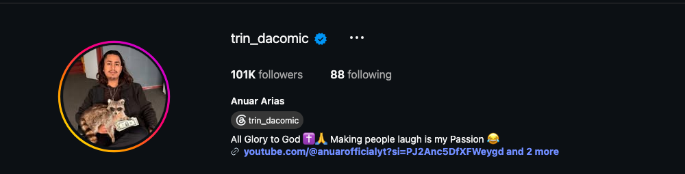
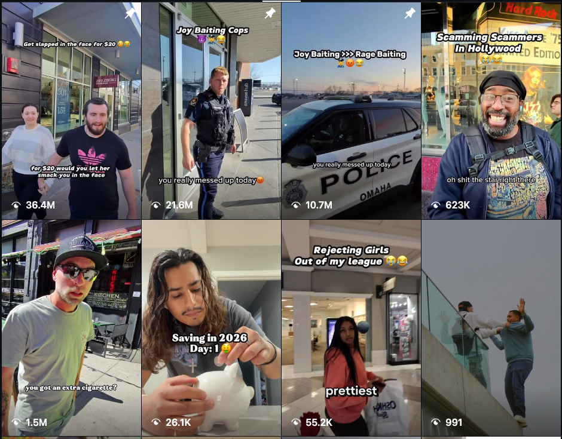
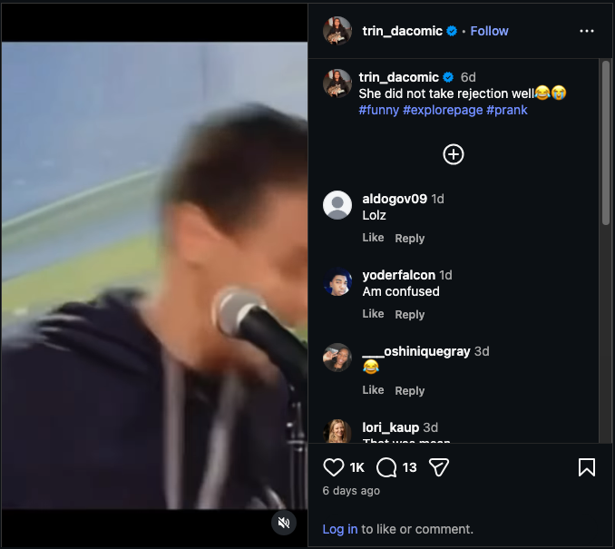
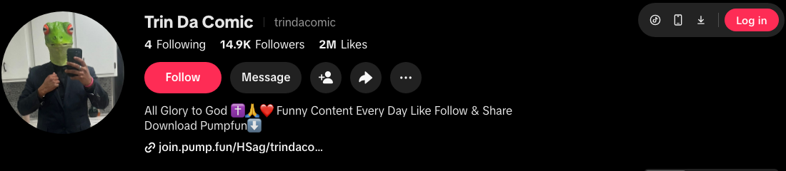
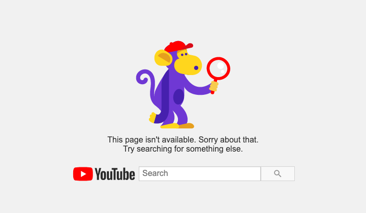

# Instagram Account Audit — @trin_dacomic

**Prepared:** September 29, 2026  
**Account:** https://www.instagram.com/trin_dacomic/ (Anuar Arias)  
**Audited by:** ALTR  
**Scope:** Public profile, bio links (YouTube/Twitch/TikTok), Reels tab with view counts, and the 12 most recent grid posts with full caption/engagement data.

---

## 1. Snapshot

Risk grade

B–

Healthy core, self-sabotaging drift

Followers

101K

Verified · following 88

Proven ceiling

36.4M

Views on pinned joy-bait reel

Recent floor

991

Views on a troll-format reel

0 CRITICAL 2 HIGH 3 MEDIUM 2 LOW

The situation in one sentence

This account got huge on wholesome "joy baiting" street content — 10–36M views on the pinned reels, 2M likes on the top posts — and its recent pivot to anger-bait troll pranks ("Bro was so MAD…", "She did not take rejection well") is dying on delivery, because that format sits squarely in the harassment-pattern category Instagram demotes and viewers report; the account is running an accidental A/B test between its two formats, and the platform has already declared the winner.

"Slapped for $20" (pinned · consensual bit)

36.4M

"Joy Baiting Cops" (pinned)

21.6M

"Joy Baiting >>> Rage Baiting" (pinned)

10.7M

Cigarette anger prank (troll)

1.5M

"Scamming Scammers" (joy-adjacent)

623K

"Rejecting Girls Out of my League" (troll)

55.2K

"Saving in 2026" (skit)

26.1K

Balcony troll reel

991

Views per reel, Reels tab, Sept 29 2026 · cream bars = joy-bait format · sage bars = the recent run. Same creator, same camera, 36,000x spread by format.

---

## 2. The Read

**He already knows the answer — it's pinned to his own profile.** The third pinned reel is literally titled "Joy Baiting >>> Rage Baiting" (10.7M views). The September grid then runs the exact format that manifesto argues against: provoking strangers into anger over a CD, a cigarette, money, and filming women's reactions to rejection.

**Why the troll run dies on delivery:** non-consensual irritation content — where the payoff is a stranger's anger or humiliation — is the harassment-pattern category from Meta's recommendation exclusions. It gets demoted per-post, it draws viewer reports (a visible comment on the rejection reel: "That was mean"), and if the run continues it graduates to account-level suppression that will drag the joy-bait content down with it.

**The reach engine still works.** The cigarette prank pulled 1.5M views six days ago — there is no account-level wall yet. This audit is about stopping the drift before there is one.

<figure><figcaption>Verified, 101K followers. Bio: "All Glory to God ✝️🙏 Making people laugh is my Passion 😂" — links to YouTube, Twitch, TikTok (all clean).</figcaption></figure>

---

## 3. Findings

### HIGH — The troll-prank run is harassment-pattern content

- **The September format:** "Bro was so mad over a CD 💿" · "Bro was so mad over a cigarette 🚬" · "More money more problems" · "She did not take rejection well" — all tagged #prank #troll, all built on a non-consenting stranger's anger or embarrassment as the punchline.
- **Policy:** content depicting people being mocked, pranked, or harassed without consent is excluded from recommendation and is report-driven — flags arrive in bursts when a clip travels, which is exactly the "random flagging" pattern this niche complains about.
- **The numbers already show it:** the troll reels land at 991–55K views against pinned joy-bait at 10.7–36.4M. The "More money" reel took 215 likes on a 101K account.
- **Fix:** end the troll run. The joy-bait formula — same streets, same strangers, positive payoff — is proven at 20–30x the reach and is fully recommendable.

<figure><figcaption>The Reels tab is the whole argument: pinned joy-bait at 36.4M / 21.6M / 10.7M — including his own "Joy Baiting >>> Rage Baiting" manifesto — above a recent row where troll-format reels sit at 55.2K and 991 views.</figcaption></figure>

### HIGH — "Rejecting girls" content is the worst of the run

- **What it is:** "Rejecting Girls Out of my League" (55.2K views) and "She did not take rejection well" (1K likes) — approaching women to film their reaction to being rejected or mocked.
- **Why it's the priority:** it stacks the harassment-pattern read with a targeted-at-women dynamic that both the classifier and the audience punish hardest (top visible comment: "That was mean"). This is the sub-format most likely to generate reports, brand-safety vetoes, and press screenshots — and it's also just off-brand for a bio that says "All Glory to God."
- **Fix:** archive both today. If the man-on-the-street dating angle stays, invert it to the joy side (compliment content, wingman bits, consensual participants who are in on it) — that version is recommendable and matches the account's actual audience.

<figure><figcaption>"She did not take rejection well 😂😭 #prank" — 1K likes on a 101K account, and the mocking-caption framing that converts a street clip into a harassment read.</figcaption></figure>

### MEDIUM — Three smaller patterns

- **Hashtag spam:** #explorepage #fyp on every post are dead-weight bait tags (they do nothing on IG and read as spam); the #prank #troll tags actively label the content for the classifier. Tag the content honestly and sparingly (#comedy, #streetinterview, location tags).
- **Volatility masking the trend:** the cigarette reel's 1.5M can make the troll run feel fine — but its sibling posts at 215–1K likes are the tell. One survivor doesn't disprove the demotion pattern; the spread does.
- **Tobacco-as-prop:** the cigarette-begging bit brushes the tobacco content bucket (teen-filtered). Not worth changing retroactively; just don't make smoking a recurring prop.

### LOW — What's healthy

- Verified; clean Instagram bio (no aggregators, codes, or funnels on IG itself); following count healthy; event promo for his Oct 17 show is fine and worth doing more of. No removal-layer content found anywhere on the reviewed Instagram grid. (The off-platform links have their own findings — see Section 6.)

---

## 4. Content Findings

| # | Post (date) | Format | Views/Likes | Severity | Action |
|---|-------------|--------|-------------|----------|--------|
| P1 | Pinned May 2026 — "Joy baiting strangers🥰" | Joy | 601K likes | LOW | Keep — the brand |
| P2 | Pinned Apr 2026 — "True Love❤️‍🩹" | Joy | 2M likes | LOW | Keep |
| P3 | Pinned Apr 2026 — "cutie patootie😳" | Joy | 2M likes | LOW | Keep |
| 1 | Sep 28 reel — "mad over a CD" | Troll | 12K likes | HIGH | Archive with the run |
| 2 | Sep 25 reel — "mad over a cigarette" | Troll | 78K likes · 1.5M views | MEDIUM | Keep (it hit) but retire the format |
| 3 | Sep 25 reel — "More money more problems" | Troll | 215 likes | HIGH | Archive today |
| 4 | Sep 23 reel — "She did not take rejection well" | Troll/women | 1K likes | HIGH | Archive today |
| 5 | Sep 22 reel — Oct 17 event promo | Promo | 253 likes | LOW | Keep; repost closer to date |
| 6 | Sep 21 reel — "She was never mine fr" | Skit | 867 likes | LOW | Keep |
| 7 | Sep 18 reel — "I love Joybaiting😂🥰" | Joy | 7.3K likes | LOW | Keep — more of this |
| 8 | Sep 18 reel — "million bucks" | Troll-lite | 891 likes | MEDIUM | Judgment call |
| 9 | Sep 16 reel — dog / owner said no | Joy-adjacent | 2K likes | LOW | Keep |

---

## 5. Two Formats, One Verdict

Joy bait — the proven brand

<ul>
<li>"Slapped for $20" — 36.4M views</li>
<li>"Joy Baiting Cops" — 21.6M views</li>
<li>"True Love" / "cutie patootie" — 2M likes each</li>
<li>Consensual, positive payoff → fully recommendable</li>
</ul>

Rage/troll bait — the drift

<ul>
<li>"More money" — 215 likes</li>
<li>Balcony troll — 991 views</li>
<li>"Rejecting Girls" — 55.2K views + report magnet</li>
<li>Anger-as-payoff → demoted, reported, off-brand</li>
</ul>

The account's own pinned manifesto said it first: **Joy Baiting >>> Rage Baiting.** This audit is just the receipts.

---

## 6. Cross-Platform Exposure

Every platform on the landing page, scored against its own rules:

| Platform | Audience | What we found | Risk on that platform | Move |
|----------|----------|---------------|----------------------|------|
| YouTube @anuarofficialyt | — | **Bio link is dead** — "This page isn't available"; no active channel found in search | First link on the IG bio sends 101K followers' clicks to a 404 | Fix or remove today; if the channel was terminated, get the email — it changes the YouTube strategy |
| TikTok @trindacomic | 14.9K · 2M likes | Same joy-vs-troll split as IG (pinned 14.6M views vs. recent clips at 2–8K) — **plus a join.pump.fun referral link in the bio** and a "Meme Coin Trader" video | Memecoin-launchpad referral = undisclosed financial promotion; TikTok auto-detects commercial content and restricts repeat offenders | Remove the Pump.fun link and video today; apply the same joy-format rule |
| Twitch trin_dacomic | 5 followers | Dormant, offline, links back to IG/YouTube | None today; note Twitch enforces off-platform conduct if he activates it | Remove from bio until streaming is real |

### HIGH — The Pump.fun referral contaminates the clean brand on TikTok

- **What it is:** the TikTok bio reads "Download Pumpfun⬇️" over a live **join.pump.fun referral link**, with a "Day in the life of Meme Coin Trader" video on the grid. Pump.fun is a memecoin launchpad — speculative crypto promotion, with a referral relationship that TikTok's branded-content enforcement treats as undisclosed commercial content (auto-detected, visibility-restricted, ban-tier on repeat).
- **Why it matters beyond TikTok:** his Instagram links to this TikTok, so the crypto funnel sits one hop from the IG audience too — the same one-hop rule Meta applies to Linktrees. And a "God + wholesome comedy" brand carrying a memecoin referral is exactly the mismatch that kills brand deals when a sponsor's vetting team finds it.
- **Fix:** remove the link and the trader video today. If crypto content is a genuine interest, it needs its own clearly-separated account — it cannot share a surface with the family-friendly brand.

<figure><figcaption>TikTok bio at audit time: 14.9K followers, 2M likes — and a live join.pump.fun referral link under "Download Pumpfun⬇️".</figcaption></figure>

### MEDIUM — The landing page's first impression is a dead link

- The IG bio's first link (YouTube @anuarofficialyt) returns "This page isn't available," and YouTube search surfaces no active comedy channel for him. Every click from 101K followers' profile visits lands on a 404.
- If the channel was renamed, fix the link; if it was **terminated**, we need the termination email — YouTube's 2025–26 rules (especially around pranks and gambling) decide what a relaunch can safely carry, and a terminated channel's content strategy can't just be re-uploaded.
- Twitch (5 followers, dormant) should come off the bio until it's real — dead links read as abandonment to both audiences and brand scouts.

<figure><figcaption>The first link on his Instagram bio, as his audience sees it.</figcaption></figure>

**Routing rule for this client:** comedy earns reach on IG + TikTok (+ a rebuilt YouTube when ready) under one format rule everywhere — strangers leave happier than they arrived. Nothing financial, nothing crypto, nothing gambling touches any surface of this brand.

---

## 7. Action Plan

**Today:**
1. Archive the two rejection-format reels and "More money more problems."
2. Remove the Pump.fun link + "Meme Coin Trader" video from TikTok; fix or remove the dead YouTube link; drop the dormant Twitch link.
3. Decide the format rule going forward, on every platform: strangers leave the video happier than they entered it. That one sentence is the whole compliance strategy.

**This week:**
1. Retire #explorepage/#fyp/#troll tags; tag honestly and sparingly.
2. Post 2 joy-bait reels (the Sep 18 "I love Joybaiting" reel at 7.3K likes vs. its troll siblings at 215–1K shows the audience is asking for it).
3. **Settings → Account Status** — screenshot both panels for baseline; we expect "can't be recommended" entries on the troll reels.

**Ongoing:**
1. Joy-bait as the spine (2–3/week), skits and event promos as seasoning; zero anger-payoff content.
2. Get quick on-camera consent/releases from featured strangers — standard practice in the street niche, kills the report risk, and happy participants sign willingly.
3. Watch for reach normalization over 2–4 weeks; the 1.5M cigarette reel says distribution recovers fast once the pattern flips.

---

## 8. What We Need From the Client

1. **Settings → Account Status** — both panels.
2. **Insights → Reach → non-follower %** for the last 90 days (we want to see the joy→troll inflection in his own data).
3. Whether any strikes/warnings arrived on the rejection reels specifically.
4. His consent practice on street shoots today (verbal? release app? none?).
5. What happened to the YouTube channel (renamed vs. terminated — forward the email if terminated), and the terms of the Pump.fun referral arrangement.

**Re-audit at 30 days:** confirm the troll run archived, format rule holding, and troll-era reels no longer listed in Account Status.

---
*This audit assesses compliance with Meta's published Community Standards and Recommendation Guidelines as understood at the audit date. Enforcement is partly discretionary; no compliance change guarantees restored reach. All recommendations aim at genuine compliance — we do not advise disguising violating content, which converts reach problems into account-loss problems.*
