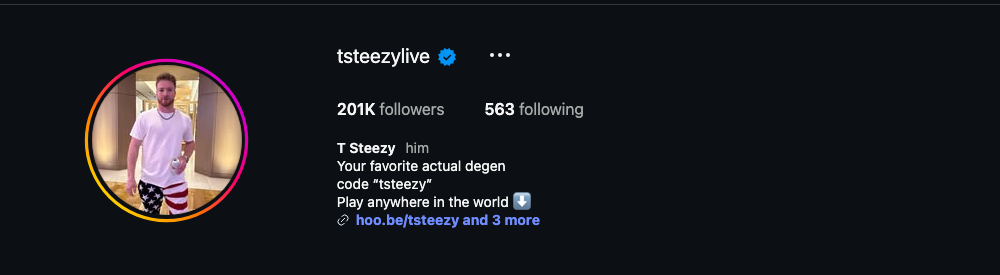
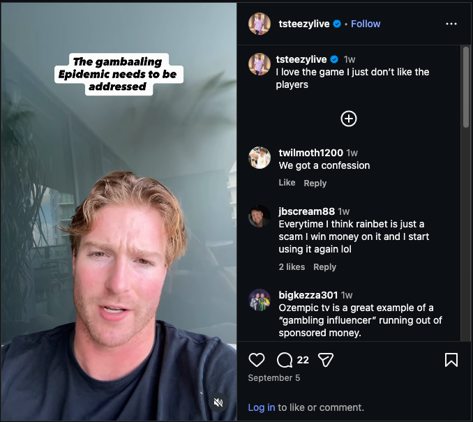
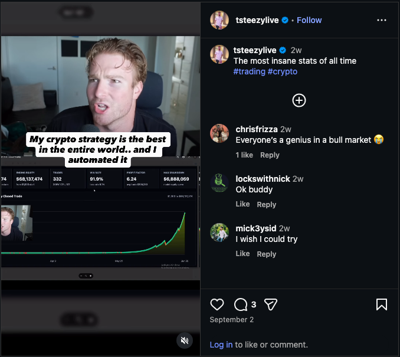
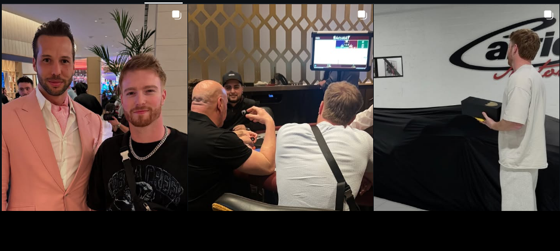

# Instagram Account Audit — @tsteezylive

**Prepared:** September 17, 2026  
**Account:** https://www.instagram.com/tsteezylive/  
**Audited by:** ALTR  
**Scope:** Public profile, full bio-link chain (hoo.be one hop), Reels tab with view counts, and the 12 grid posts accessible logged-out.

---

## 1. Snapshot

Risk grade

F

Removal-layer exposure

Followers

201K

Verified · following 563

Recent reel views

1.6–7.8K

0.8–4% of audience

Pinned reel views

142K

Reach works when content allows

2 CRITICAL 3 HIGH 3 MEDIUM 1 LOW

The problem in one sentence

The account's entire monetization model — casino referral code in the bio, Rainbet referral + geo-routing link one hop away, native casino-ad reels, and a paid trading Discord sold with fabricated-looking profit claims — is built on two categories Meta enforces at the removal/strike layer. No caption rewrite fixes that; the funnel has to come off Instagram.

POV: You bet on yourself (pinned, clean)

142K

Spiders in my Lamborghini

7,862

Parlay leg touchdown

6,417

"3,000 on 3 hands!" blackjack

3,402

Semi truck vs Lamborghini

2,281

Sunday football "blooody nose"

1,982

Casino "One and a dream"

1,652

Cold plunge morning

1,650

Views per reel, Reels tab, Sept 17 2026 · 201K followers · recent reels reach 0.8–4% of the audience the pinned reel proves is reachable.

---

## 2. The Three Moves

Views above are public Reels-tab counts: one clean pinned reel reaches six figures while everything recent flatlines — account-level suppression, visible from outside. Everything in this report supports three moves, all executable today:

**Move 1 — today:** Strip "code 'tsteezy'" and "Play anywhere in the world" from the bio; pull Rainbet and the zotatraff redirect off hoo.be.

**Move 2 — today:** Delete the three worst posts: the Rainbet-ad reel, the "$68M / 91.9% win rate" reel, and the "1,000,000/m crypto strategy" reel.

**Move 3 — today:** Unpin the apparent Tristan Tate photo and the "2 lambos in 1 month" trading flex.

Everything else in this report is detail supporting these three moves — and the case that the clean lifestyle content already outperforms the promo content.

<figure><figcaption>The bio IS the violation: "Your favorite actual degen / code "tsteezy" / Play anywhere in the world ⬇️" — a casino referral pitch on the profile surface itself.</figcaption></figure>

---

## 3. Account-Level Findings

### CRITICAL — An unpermitted real-money gambling funnel, on-platform

- **The machine:** bio code + "Play anywhere in the world" → hoo.be one hop out → **"PLAY ONLINE WHERE I PLAY CODE: tsteezy"** on Rainbet, plus a **zotatraff.com geo-routing affiliate redirect** and a Kick giveaway card. Native reels advertise Rainbet directly — the Sep 5 reel's own comments call it ("bruh you had me til rainbet ad lmao"). No paid-partnership labels anywhere.
- **Policy:** real-money gambling promotion requires Meta's prior written permission; referral promos never have it. **Removal/strike layer.** The geo-workaround framing is the version platforms and regulators treat most harshly.
- **Why rewording can't fix it:** the bio, the link chain, the pinned content, and the ad reels are scored together as one pattern. The funnel must come off Instagram — gambling monetization lives on Kick/stream platforms that permit it.

<figure><figcaption>One hop from the bio: Rainbet referral with code, the "Tailored Taylor Trades" Discord, Kick giveaways, YouTube "long sessions." The whole funnel in one frame.</figcaption></figure>

- **The ad reel, in his audience's own words:** "Everytime I think rainbet is just a scam I win money on it and I start using it again lol" · "Rainbet is a scam" · "'Gotten outta control' like you arent 100% profiting from it 😭" · "…a 'gambling influencer' running out of sponsored money."
- The overlay's deliberate misspelling — "gamb**aa**ling" — is filter evasion, covered as its own finding below.
- **Fix:** delete this reel today; archive the casino-table set this week.

<figure><figcaption>Sep 5 reel: concern-framed, but a casino ad — and the comment section knows it.</figcaption></figure>

### CRITICAL — Fabricated-looking trading claims selling a paid Discord

- **The claims:** "$68,137,474 ending equity · 332 trades · **91.9% win rate**" under "My crypto strategy is the best in the entire world.. and I automated it"; a second reel titled "**1,000,000/m crypto strategy**"; a pinned "**2 lambos in 1 month**" post. All of it feeds the "Tailored Taylor Trades" Discord.
- **Policy:** deceptive financial-services promotion — unrealistic earnings claims selling financial access. Removal-layer, and the pattern (cash flex + "use my code" + too-good-to-be-true stats) is the exact template Meta's scam classifiers train on.
- **Fix:** no compliant version of these numbers exists. Delete the claims posts; any future trading content is process-not-profits, with disclosure.

<figure><figcaption>Sep 2 reel: the $68M / 91.9% dashboard. Audience comments take it at face value ("I wish I could try").</figcaption></figure>

### HIGH — Deliberate filter-evasion spelling

- "gamb**aa**ling," "bl**ooo**dy" — misspellings engineered to dodge keyword filters. Meta treats adversarial evasion as proof of knowing violation: it upgrades demotions to strikes and poisons appeals. It also doesn't work — classifiers read audio, video, and context.
- **Fix:** stop everywhere, immediately; never cite these posts in an appeal.

### HIGH — Pinned row leads with the three biggest risk signals

- The first thing any reviewer (or brand) sees: an apparent **Tristan Tate** photo (the Tates are banned from Meta platforms; celebratory content is itself enforceable), a **baccarat table** with UFC brass tagged "#gambling," and a Lamborghini reveal captioned "2 lambos in 1 month… #trading."
- **Fix:** unpin all three today. The UFC/Vegas personality content can stay in the grid — un-pinned and un-hashtagged — but the Tate frame should be archived entirely.

<figure><figcaption>The pinned row at audit time: banned-individual association, casino table, earnings-claim flex — before a reviewer sees a single reel.</figcaption></figure>

### MEDIUM — Three compounding content patterns

- **Addiction confessionals while selling the casino:** "Not proud of it, man enough to say it" (top comment: "Train your brain to enjoy lower stakes"), "I think I'm addicted," "I went risked it all." Self-harm-adjacent moderation bucket + the combination that draws reports. It cannot coexist with selling the product.
- **Casino-floor and betting-slip content generally:** age-gated, teen-filtered, non-recommendable even when it doesn't strike. While gambling is the content spine, the reach ceiling stays near zero.
- **Kick giveaway promotion:** gambling-adjacent giveaway inducement; keep giveaways fully on Kick, unreferenced from Instagram.

### LOW — What's already healthy

- Following count (563) is clean; LIFE/SKIING highlights are clean lifestyle content. Sweep the STREAMING highlight for casino clips (not visible logged-out).

---

## 4. Content Findings

| # | Post (date) | Issue | Severity | Action |
|---|-------------|-------|----------|--------|
| 1 | Sep 14 reel — "I need to find these beans" | Clean lifestyle bit | LOW | Keep |
| 2 | Sep 5 reel — "gambaaling" Rainbet ad | Unlabeled casino ad + evasion | CRITICAL | **Delete today** |
| 3 | Sep 3 reel — "It's all public" | Trading-receipts flex → Discord funnel | HIGH | Delete or strip claims |
| 4 | Sep 2 reel — $68M / 91.9% dashboard | Unsubstantiable earnings claims | CRITICAL | **Delete today** |
| 5 | Aug 31 reel — raccoon (137 likes) | Clean | LOW | Keep |
| 6 | Aug 27 reel — Lambo spiders (593 likes, 7.8K views) | Clean; best recent performer | LOW | Keep — the model |
| 7 | Aug 1 reel — "Not proud of it" (467 likes) | Gambling-loss confessional | MEDIUM | Archive |
| 8 | Jul 31 reel — "risked it all" (403 likes) | Gambling-loss content | MEDIUM | Archive |
| 9 | Jul 27 reel — golf 6-iron (62 likes) | Clean | LOW | Keep |
| P1 | Pinned Mar 2025 — Vegas/UFC, apparent Tate, #gambling | Banned-individual + gambling | HIGH | Unpin; archive Tate frame |
| P2 | Pinned Aug 2025 — birthday dump #degen | Hashtag hygiene | LOW | Retag |
| P3 | Pinned Nov 2025 — "2 lambos in 1 month" | Earnings-claim flex | HIGH | Unpin; cut the claim |

*Also on the grid (permalinks not exposed logged-out): the "1,000,000/m crypto strategy" reel (CRITICAL — delete with #4), the clean 142K "POV: You bet on yourself" pinned reel (keep), and the blackjack/parlay set (MEDIUM — archive with the casino content).*

---

## 5. Two Accounts, One Grid

What wins — keep &amp; scale

<ul>
<li>Lambo spiders — 7,862 views · 593 likes</li>
<li>"POV: You bet on yourself" — 142K views</li>
<li>Raccoon rescue, golf fails, cold plunge, skiing</li>
<li>Vegas personality without a table in frame</li>
</ul>

What kills — remove

<ul>
<li>Casino code in bio + Rainbet funnel</li>
<li>$68M / 91.9% trading claims → paid Discord</li>
<li>Casino tables, parlay slips, loss confessionals</li>
<li>Evasion spellings; Tate pin; #gambling #degen</li>
</ul>

The client's own numbers make the argument: the clean content is his **best-performing** content. This isn't a reinvention — it's a subtraction.

---

## 6. Action Plan

**Today (urgent — standing strike inventory):**
1. Bio: delete the code line and "Play anywhere in the world"; rewrite as lifestyle-brand copy ("Vegas. Golf. Bad decisions with good lighting.").
2. Links: remove Rainbet + zotatraff from hoo.be (and the Discord card while it's sold with earnings claims).
3. Delete reels #2 and #4 and the "1,000,000/m" reel; unpin P1/P3.

**This week:**
1. Archive the casino-table set and both loss-confessional reels.
2. Stop all evasion spellings permanently.
3. Sweep STREAMING highlight + stories for casino content.
4. **Settings → Account Status:** screenshot both panels; appeal only genuinely clean removals.
5. Move gambling monetization entirely to platforms that permit it; zero Instagram breadcrumbs.

**Ongoing:**
1. 2–3 lifestyle-comedy reels weekly in the proven lane (animals, golf, cars, Vegas absurdity).
2. Trading content, if any: process-not-profits, no dollar amounts, disclosure on anything sponsored.
3. Expect reach to move in 4–6 weeks post-cleanup; if it doesn't, the existing strike history (Section 7) is the blocker — decay timelines show in Account Status.

---

## 7. What We Need From the Client

1. **Settings → Account Status** — both panels + all violation notices from the last 180 days (category and date).
2. **Insights → Reach → non-follower %** (30/90 days) and view counts on the like-hidden posts.
3. Rainbet sponsorship terms; the Discord's pricing/pitch materials.
4. Contents of the STREAMING highlight.
5. Any past boosting/ad activity on gambling content.

**Re-audit at 30 days:** confirm deletions, link chain clean, Account Status trajectory, and new reels climbing off the 2K floor.

---
*This audit assesses compliance with Meta's published Community Standards, Recommendation Guidelines, and restricted-goods policies as understood at the audit date. Enforcement is partly discretionary; no compliance change guarantees restored reach. All recommendations aim at genuine compliance — we do not advise disguising violating content (including the misspelling tactics documented above), which converts reach problems into account-loss problems.*
